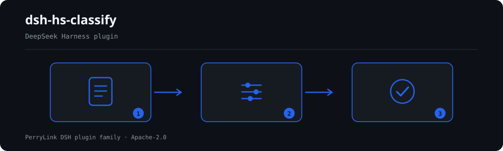

# dsh-hs-classify — 商品归类层级一致性核对

[English](README.md) · [简体中文](README-zh.md) · [Español](README-es.md) · [Português](README-pt.md) · [हिन्दी](README-hi.md)

<!-- topblock:v1 -->
> **这是什么**　商品归类层级一致性核对。输出一份「哪一行、哪一栏、差什么」的清单。
> **给谁用**　报关员、归类员；不用懂命令行。
> **你交什么**　这项核对用到的原始材料（表格、清单或文书）；不改原件。Excel 可先转成 JSON/YAML，对话里也能代转。
> **它不做什么**　不判合规、不认定责任、不替代审核人；只列材料内部能逐条指认的差异。
> **怎么开始**　在 WorkBuddy / 扣子搜「关务合规核对包」（本检查是其中一项；上架以商城为准）；或命令行：
> `dsh plugin --profile <name> add dsh-hs-classify`
<!-- /topblock:v1 -->

[](https://dsh.market/)
[](https://dshfind.com/en/plugins/PerryLink/dsh-hs-classify?ref=badge)

`dsh-hs-classify` 读取一份商品归类台账——表头加每个商品项一行——核对其中编号的结构：商品编号是否为十位数字、章／品目／子目是否为该编号的逐级前缀、层级是否由粗到细、每行是否填写归类依据、表头是否声明商品编号适用的税则版本、项号是否在台账内唯一、品名栏是否残留未替换的占位符。

## Install

```sh
dsh plugin --profile <name> add dsh-hs-classify
dsh --profile <name> --dump-config | grep 'dsh-hs-classify'
```

## 实际输出长什么样



*工作流概览：调用 → 插件 → 结果。下面的示例使用实际命令面。*


本插件对自己 `HC-001` 测试夹具的**真实输出**，不是示意图。规则库不伪造引文，因此每条发现都会同时写明所引条款，以及该条款原文本次未取得。

## 它回答什么问题

### 示例

下表是示例集：第一行是详细走查，其余行是简短案例。

#### 详细输出

**工具** `hs_classify`

**输入**

~~~json
{"rows":[{"品名":"便携式自动数据处理设备","子目":"847140","商品编号":"8471300000"}]}
~~~
 
**输出**

~~~json
{
  "id": "dsh-hs-classify.HC-002.de09b5a6",
  "ruleId": "HC-002",
  "severity": "warn",
  "locator": {
    "field": "subheading",
    "row": 1
  },
  "found": "第 1 行「subheading」为「847140」，不是「hsCode」（8471300000）的前缀",
  "expected": "「subheading」应与「hsCode」的前几位一致",
  "fix": "核对层级填写；本条只核对前缀关系，不判断归类是否正确"
}
~~~

*来源 `tests/fixtures/HC-002/HC-002-unsafe.json (cases.json expects HC-002 count 1); run via lib/index.mjs rules/hs-classify.yaml`*

| 你会问 | 它怎么答 |
|---|---|
| 台账里的编号有的是八位，还有一个末位是字母，会被报出吗？ | 会。`HC-001` 把每个已填写的 `hsCode` 与规则库的 `pattern`（`^[0-9]{10}$`）比对，报出该行并附上它读到的值。它只核对位数与字符合法性，绝不判断该商品是否应归入这个编号。编号栏留空的不在本条范围内，所以它报的是形式不对的编号，不是缺填的编号。十位是规则库配置：年度税则改了位数，改 `pattern` 即可，不必改代码。 |
| 某行的章、品目、子目与商品编号对不上，能查出来吗？ | 能。`HC-002` 按由粗到细的顺序读取层级栏——章、品目、子目，规则库自己的示例为 2、4、6 位——报出不是所读 `hsCode` 前缀的那一栏，或不比上一级更细的那一栏。它只核对这一前缀关系与这一顺序：编号是否适用于该商品属海关的归类判断，要查税则与归类决定，本插件不查这些。层级栏留空的不作比较。 |
| 有一行的归类依据是空的。 | `HC-003` 会报出这一行：凡是带这一栏的行，`basis` 都必须填写。它只核对该栏写了没有，不核对所引税则条文、章注、归类决定或预裁定是否存在、是否支持该归类——这些本插件都不查。台账若完全没有 `basis` 栏，`HC-003` 会在 `skipped` 中说明「材料没有『basis』列，本条不适用」，而不是静默通过。 |
| 表头没有声明这些编号适用哪一版税则。 | `HC-004` 要求表头声明 `tariffVersion`，表头留空即报出该台账。它只核对声明在不在，不判断所写的版本是不是这些编号所属的那一版——本条不读编号，而编码会在各版税则之间拆分与合并。它检查的 `fields` 是规则库配置：表头还记申报人的话，把 `declarant` 加进去即可。 |
| 项号 5 在两行里各出现一次。 | `HC-005` 会把后一行报为与前行重复：`itemNo` 在同一台账内应唯一，比较时忽略空白字符，所以 `5` 与 ` 5 ` 是同一个项号。它只核对唯一性。同一商品分多行申报（例如不同规格）时，每行要用不同的项号。项号全都不重复时，`HC-005` 仍会出现在 `skipped` 中：此时给的理由是「材料满足该检查的前置条件且未发现差异条目」，与规则因缺列而无法执行时给的理由不同。 |
| 品名栏还留着模板里的【】或待填。 | `HC-006` 会报出该行以及它匹配到的占位符。规则库查找的是【、】、{{、}}、XXX、xxx、待填、待补充、TBD、todo 与 示例，`terms` 可按本机构模板增减。它只找未替换的占位符：不判断品名对不对，也不要求这一栏必须填写——`description` 单元格留空不会产生差异条目，本规则库中也没有别的规则要求填写品名。 |

## 依据的标准

| 文件 | 文号 | 引用它的规则 |
|---|---|---|
| 《中华人民共和国进出口税则》 | 现行版本本次未核实 | HC-001, HC-004, HC-005, HC-006 |
| 《商品名称及编码协调制度》 | 现行版本本次未核实 | HC-002 |
| 《中华人民共和国进出口关税条例》 | 国务院令第392号（2003年11月23日公布；根据2011年1月8日、2013年12月7日、2016年2月6日三次《国务院关于修改（废止）部分行政法规的决定》修订） | HC-003 |

**边界（中文译文，以英文原文为准）：** 本插件核对一份**商品归类台账**所记录编号的*结构*——商品编码是否为十位，其章、品目与子目是否依次为该编码的前缀，层级是否逐级细化，是否记录归类依据，是否声明税则版本，项号是否唯一，以及是否残留占位符。它**不**判定商品应当归入哪个编码。

> ### ⚠️ 它核对的是编码的形态，从不判断编码是否正确（以英文原文为准）
>
> **归类是一项海关裁定**，取决于商品的材料、功能与加工深度，连同税则的类注、章注，以及任何归类决定或预裁定。**本插件不查阅税则，不查阅归类决定，也不查阅裁定。** 因此：
>
> - 它**能**发现「这一行的编码与同一行所写的章、品目和子目不一致」；
> - 它**不能**发现「这一行的编码与货物不相符」，因为那需要税则本身。
>
> 一份给错误货物配上结构上完美编码的台账，会通过本插件。这就是已记录的边界，写在规则库库头、`HC-002` 的说明以及排障一节中。
>
> **规则库中的每一个 `excerpt` 都明文写着：条款原文本次未取得。** 该制度见于《中华人民共和国进出口税则》——其编码为十位，前六位为 WCO 协调制度——以及《中华人民共和国进出口关税条例》。核验环节无法取得逐字条款原文，因此规则库在 `excerpt` 字段本身写明这一缺口，并把每条规则保持在 `warn` 或 `info`。**待取得原文后，请把每个 `excerpt` 换成真实条款，并把 `kind` 提到 `direct`。** 十位编码这一假设是规则库中的一条 `pattern`，因此年度税则变更需要改规则库，而不是改代码。

## Compatibility

| 项目 | 状态 |
|---|---|
| Harness | 对等版本范围 `>=0.1.2-rc.1 <0.2.0 \|\| >=0.2.0-0 <0.3.0` —— 已实测同时接受 `0.2.0-rc.2` 与 `0.2.1-rc.2`。**已声明 `engines.dsh`**：0.2.1 起由宿主单独裁决，范围为 `>=0.2.1-0 <0.3.0` |
| Node | `^22.19.0 || >=24.0.0` |
| 平台 | 全平台（纯 ESM；无原生代码、无联网、不调用模型） |
| 工具模式 | `native` / `ptc` 均可；批量校验整个目录时建议 `ptc`，schema 成本只付一次 |

## What it does

规则表、字段说明与行为细节见 [README.md](README.md#what-it-does)（英文主版本）。本插件只列出材料与所引条款之间的字面差异，并对无法执行的检查在 `skipped` 中逐项说明。

## Configuration

全部可调参数都在 `src/config.ts` 的 Schemastery schema 中，只改 `cordis.yml` 即可生效，无需改代码；逐条阈值在 `rules/` 下的规则库文件里。

| 键 | 类型 | 默认值 | 说明 |
|---|---|---|---|
| `rulesFile` | string | `rules/hs-classify.yaml` | 规则库文件路径，相对插件包根目录 |
| `disabledRules` | string[] | `[]` | 要停用的规则 id 列表；每条都会出现在 `skipped` 中 |
| `onlyRules` | string[] | `[]` | 只执行这些规则 id；留空表示执行全部规则 |
| `skipNotes` | string | `""` | 附加到每条 `skipped` 说明后的备注 |
| `timeoutMs` | number | `120000` | 工具协作式超时预算（毫秒） |

## Material format

支持 JSON 与 YAML。完整字段示例见 [README.md](README.md#material-format)（英文主版本）。字段在读取层是可选的，由检查引擎校验，因此部分导出的材料会产生"缺项"类差异，而不是让程序崩溃。

## Rule sources

规则数据与代码分离，每条规则都带文件名、文号、按原文自身编号体系的条款号、逐字摘录与来源地址。加载期强制：摘录必须是真实引文且不少于八个字符；依据仅为原则性条款（`kind: derived-from-principle`，严重级上限 `warn`）或本机构配置（`kind: institutional-configuration`，上限 `info`）的检查不得标为 `error`。夸大依据的规则库会在加载期失败，而不会产出一份看起来很有底气的报告。

核验中确认的边界与"刻意没有作出的结论"见 [README.md](README.md#rule-sources)（英文主版本）与随包的 `rules/evidence/` 目录。

## Troubleshooting

- **插件装上了但工具不出现**：确认 `main` 指向 `lib/index.mjs` 且 `pnpm run build` 已生成该文件；`main` 写错会让加载器静默跳过该条目。
- **`dsh plugin add` 报版本不兼容**：peer 范围覆盖 `0.1.x` 与 `0.2.x`；若运行时在其之外，可显式豁免：`dsh plugin --profile <name> allow-version <包名@版本> --dsh-version <runtime> --accept-risk`
- **某条规则没有执行**：查看 `skipped` 数组，其中写明了规则 id 与原因。
- **`check` 报 `manifest-peers` 失败**：静态检查器比对的是一份早于 0.2 世代的硬编码 peer 范围；安装期的 peer 校验以运行时为准。这是 `dsh-plugin-dev` 的已知上游问题。
- **时间看起来偏移**：全部计算都是对输入字符串做墙上时钟运算，不做时区换算。

## Development

```sh
pnpm install
pnpm run typecheck
pnpm test
pnpm run build
node ../scripts/sync-shared.mjs dsh-hs-classify
```

第 4 项把 `../_shared` 的共享件同步进 `src/shared/`；每次改动共享件后都要重跑。

## PerryLink DSH Plugin Family

完整清单（62 个核查器 + 通用插件）见 [按材料选核查器](https://perrylink.github.io/zh/checkers/choose/)；本仓只是其中一个。

## License

[Apache License 2.0](LICENSE) © 2026 dsh-hs-classify contributors.
