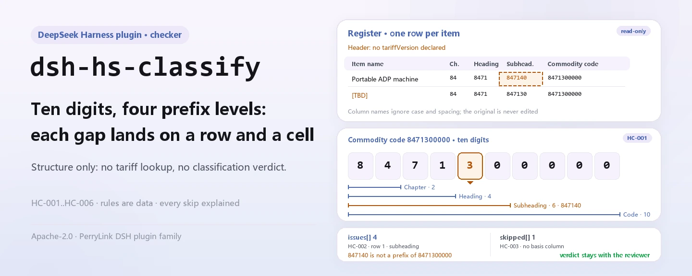
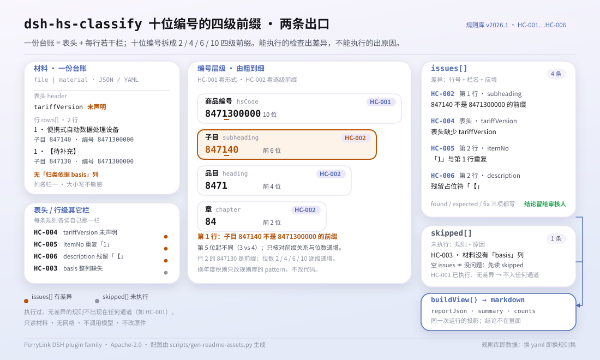

<div align="center">

<picture>
  <source media="(prefers-color-scheme: dark)" srcset="docs/assets/dsh-hs-classify-hero-en-dark.webp">
  
</picture>

# dsh-hs-classify

**Check a whole commodity-classification register: which row, which column, what differs — one line at a time.**

A DeepSeek Harness checker for customs declarants and classifiers: it checks the self-consistency of codes and levels only — no edits, no tariff lookup, no classification verdict.

[Install](#three-step-setup) · [Configuration](#configuration) · [FAQ](#faq) · [简体中文](README.md) · [English](README.en.md) · [Español](README.es.md) · [Português](README.pt.md) · [हिन्दी](README.hi.md)

[](LICENSE)
[](#compatibility)
[](https://www.npmjs.com/package/dsh-hs-classify)
[](https://github.com/PerryLink/dsh-hs-classify/actions/workflows/ci.yml)
[](#compatibility)

[](https://github.com/PerryLink/dsh-hs-classify/stargazers)
[](https://www.npmjs.com/package/dsh-hs-classify)
[](https://dshfind.com/plugins/PerryLink/dsh-hs-classify?ref=badge)
[](https://securityscorecards.dev/viewer/?uri=github.com/PerryLink/dsh-hs-classify)
[](https://dsh.market/)
[](https://gitee.com/perrylink/dsh-hs-classify)

```sh
dsh plugin --profile <name> add dsh-hs-classify
```

</div>

<sub>Community plugin, not affiliated with DeepSeek. Canonical repository: <https://github.com/PerryLink/dsh-hs-classify> (Gitee is a mirror).</sub>

## What it is

`dsh-hs-classify` reads one commodity-classification register — the declarant header plus one row per item — and checks the structure of the numbers it records: that a commodity code is ten digits, that its chapter, heading and subheading are successive prefixes of the code, that the levels get progressively finer, that each row records a classification basis, that the header declares the tariff version the codes belong to, that item numbers are unique within the register, and that no unreplaced placeholder survives in the item name. It returns the differences as "which row, which column, what differs", and every check that could not run is listed in `skipped` with its reason. It does not modify the original, does not upload the material, does not consult the tariff, and does not decide which code the goods belong under.

<picture>
  <source media="(prefers-color-scheme: dark)" srcset="docs/assets/dsh-hs-classify-flow-v5-dark.svg">
  
</picture>

## Three-step setup

1. **Install** (pick one channel):

   ```sh
   # npm channel (published releases)
   dsh plugin --profile web add dsh-hs-classify
   # git channel (latest main)
   dsh plugin --profile web add github:PerryLink/dsh-hs-classify
   # tarball channel: pnpm pack in this repo, then
   dsh plugin --profile web add ./dsh-hs-classify-<version>.tgz
   ```

   The npm and tarball channels install built artifacts; the git channel runs the repository's `prepare` script (tsdown) to produce `lib/`.

2. **Minimal config** (the defaults already work; the whole row can be omitted):

   ```yaml
   - insert:
       - id: dsh-hs-classify
         name: dsh-hs-classify
         config:
           rulesFile: rules/hs-classify.yaml
   ```

   Every tunable is in [Configuration](#configuration); the rule pack itself is a data file, so replacing `rules/hs-classify.yaml` switches the rule set.

3. **Verify it mounts**:

   ```sh
   dsh --profile web --dump-config | grep 'dsh-hs-classify'
   node samples/quickstart/run.mjs
   ```

   ```text
   hs_classify: 2 issue(s) — error 0, warn 2, info 0
   skipped: 0
   ```

   The sample input lives in `samples/quickstart/input/`, the expected result in `samples/quickstart/expected/result.json`, and the first-run screenshot in [`docs/assets/quickstart.png`](docs/assets/quickstart.png).

**Uninstall**: `dsh plugin --profile web remove dsh-hs-classify` (or remove the row from the profile patch).

## Core capabilities

- **Six rules, every finding traceable** — each finding carries a `ruleId`, the row and field, the value that was read, the expected relation, and a review hint; the rule table follows.
- **Differences, never verdicts** — no compliance finding, no liability finding, no replacement for the reviewer; a wording guard enforces this and every rendered report carries the disclaimer.
- **An empty result is not a clean bill** — every check that could not run is listed in `skipped` with its reason: absent column, all-blank column, unmet precondition, disabled rule.
- **The rule pack is data** — replace `rules/hs-classify.yaml` to switch the rule set without touching TypeScript; the loader validates the fields and the severity caps.
- **Local only** — it reads the file or inline material you pass to the tool; no network requests, no telemetry, no model calls.

| Rule | Checks | Severity | Basis kind |
|---|---|---|---|
| `HC-001` | the commodity code is ten digits | warn | principle |
| `HC-002` | chapter, heading and subheading are successive prefixes of the code | warn | principle |
| `HC-003` | every row records a classification basis | warn | direct |
| `HC-004` | the header declares the tariff version | warn | principle |
| `HC-005` | item numbers are unique within the register | warn | principle |
| `HC-006` | the description holds no unreplaced placeholder | warn | principle |

## What it answers

The table below is the example set: the first row is the detailed walkthrough, the remaining rows are short cases; the answers come from the rule pack and the shipped check behaviour.

#### Detailed output

**Tool** `hs_classify`

**Input**

~~~json
{"rows":[{"品名":"便携式自动数据处理设备","子目":"847140","商品编号":"8471300000"}]}
~~~

**Output**

~~~json
{
  "id": "dsh-hs-classify.HC-002.de09b5a6",
  "ruleId": "HC-002",
  "severity": "warn",
  "locator": {
    "field": "subheading",
    "row": 1
  },
  "found": "第 1 行「subheading」为「847140」，不是「hsCode」（8471300000）的前缀",
  "expected": "「subheading」应与「hsCode」的前几位一致",
  "fix": "核对层级填写；本条只核对前缀关系，不判断归类是否正确"
}
~~~

*Observed from `tests/fixtures/HC-002/HC-002-unsafe.json (cases.json expects HC-002 count 1); run via lib/index.mjs rules/hs-classify.yaml`*

| You ask | What it answers |
|---|---|
| Some codes in our register are eight digits, and one ends with a letter. Will the check report them? | Yes. `HC-001` matches every filled `hsCode` against the pack's `pattern`, `^[0-9]{10}$`, and reports the row together with the value it read. It checks the digit count and the characters only, never whether the goods belong under that code. A blank code cell is passed over, so what it reports is a code of the wrong shape, not a code that is missing. The ten digits are a pack setting: when the annual tariff changes the length, edit the `pattern`, not the code. |
| A row's chapter, heading and subheading do not agree with its commodity code. Is that caught? | Yes. `HC-002` reads the level columns in coarse-to-fine order — chapter, heading, subheading, two, four and six digits in the pack's own example — and reports the level that is not a prefix of the `hsCode` it read, or that is not finer than the level above it. It checks that prefix relation and that order only: whether the code fits the goods is a customs determination needing the tariff and the classification decisions, which this plugin does not consult. A blank level cell is not compared. |
| One row leaves the classification basis blank. | `HC-003` reports that row: `basis` has to be filled in on every row that carries the column. It checks that something is written there, not that the tariff clause, chapter note, classification decision or advance ruling cited exists or supports the classification — this plugin consults none of them. If the register has no `basis` column at all, `HC-003` is listed in `skipped` with the reason that the material has no such column, instead of passing silently. |
| The header does not say which tariff version the codes belong to. | `HC-004` requires the header to declare `tariffVersion` and reports the register when the header leaves it empty. It checks that the declaration is present, not that the edition named is the one these codes come from: the rule does not read the codes, and codes are split and merged between editions. Its `fields` list is a pack setting — add `declarant` if your header records one. |
| Item number 5 appears on two rows. | `HC-005` reports the later row as a duplicate of the earlier one, because `itemNo` has to be unique within one register; whitespace is ignored in the comparison, so `5` and ` 5 ` count as the same item number. It checks uniqueness only. If one goods item is declared on several rows (for different specifications, for example), each row needs a different item number. Item numbers that are all distinct produce no finding and do not enter `skipped`: the check ran and found no difference; only an absent or all-blank column makes it skip. |
| The description column still holds template placeholders. | `HC-006` reports the row and the placeholder it matched. The pack looks for `【`, `】`, `{{`, `}}`, `XXX`, `xxx`, `TBD`, `todo`, the template words for "to be filled" and "to be completed", and the literal word for "example"; `terms` can be trimmed to your own template. It finds unreplaced placeholders only: it does not judge whether the name is right, and it does not require the column to be filled — a blank `description` cell draws no finding from it, and no other rule in this pack requires one. |

## Configuration

All tunables are Schemastery fields in `src/config.ts`, so they change from `cordis.yml` without editing code; per-rule thresholds live in the rule pack under `rules/`.

| Key | Type | Default | Meaning |
|---|---|---|---|
| `rulesFile` | string | `rules/hs-classify.yaml` | Rule-pack path, relative to the package root |
| `disabledRules` | string[] | `[]` | Rule ids to stop running; each appears in `skipped` |
| `onlyRules` | string[] | `[]` | Run only these rule ids; empty runs every rule |
| `skipNotes` | string | `""` | Note appended to every `skipped` reason |
| `timeoutMs` | number | `120000` | Cooperative tool timeout budget in milliseconds |

Example profile-patch override:

```yaml
- insert:
    - id: dsh-hs-classify
      name: dsh-hs-classify
      config:
        onlyRules: [HC-001, HC-002]
        skipNotes: checked against our internal review rules
```

## Material format

The tool accepts JSON or YAML, as a file (`file`) or inline text (`material`):

```yaml
declarant: 某某报关行
tariffVersion: 2026 年版税则
rows:
  - { 序号: '1', 品名: 便携式自动数据处理设备, 材质: 塑料外壳、金属结构件、电子元器件,
      功能: 数据处理与显示，重量 1.2 千克, 章: '84', 品目: '8471', 子目: '847130',
      商品编号: '8471300000', 申报日期: 2026-03-10,
      归类依据: 税则第八十四章章注及品目 8471 条文 }
```

Column names are matched case-insensitively and ignoring spaces, underscores and hyphens; the register's own column names are kept, so a finding names the column it read. The header fields and column aliases are declared once in `src/model.ts`; the material must carry at least one of `hsCode` / `description` / `chapter` / `heading`. Fields are optional at the reader layer and validated by the check engine, so a partial export produces "missing field" findings instead of a crash.

## Rule sources

| Document | Number | Cited by rules |
|---|---|---|
| Customs Import and Export Tariff of the People's Republic of China | current edition not verified in this pass | HC-001, HC-004, HC-005, HC-006 |
| Harmonized Commodity Description and Coding System | current edition not verified in this pass | HC-002 |
| Regulations of the People's Republic of China on Import and Export Duties | State Council Decree No. 392 (promulgated 23 November 2003; revised 8 January 2011, 7 December 2013 and 6 February 2016) | HC-003 |

Rule data is separate from code: `plugin`, `version`, `rules` and `disabled` all live in `rules/hs-classify.yaml`. Every rule must carry `document` / `number` / `clause` / `excerpt` / `kind` / `source`, and the loader enforces that an `excerpt` is a real quotation of at least eight characters, and that a check whose basis is only a principle (`kind: derived-from-principle`, capped at `warn`) or an institutional setting (`kind: institutional-configuration`, capped at `info`) is never declared `error`. An overstated pack fails at load instead of producing a confidently worded report.

**Rule-pack parameters** (edit `rules/hs-classify.yaml`, not code):

| Rule | Parameter | Effect |
|---|---|---|
| `HC-001` | `pattern` | the code's shape, `^[0-9]{10}$` by default; change it when the tariff changes the length |
| `HC-002` | `field` / `components` / `digits` | the code column, the level columns in coarse-to-fine order (`[chapter, heading, subheading]`) and the expected total length |
| `HC-004` | `fields` | header fields that must be present; `[tariffVersion]` by default, add `declarant` if your header records one |
| `HC-006` | `terms` | the placeholder list to look for |

The boundaries verified and the conclusions deliberately **not** drawn are recorded in the shipped `rules/evidence/clause-verification-tariff-regulation.md`. **Only 1 of the 6 rules (`HC-003`) quotes verbatim clause text and is marked `direct`**; the other 5 state in the `excerpt` field itself that the text was not obtained and stay at `warn` or `info`. Where a rule still carries that note, treat it as a lead rather than as a citation; when the text is in hand, replace the `excerpt` and raise `kind` to `direct`. The ten-digit assumption is a `pattern` in the rule pack, so an annual tariff change needs a rule-pack edit, not a code change.

## FAQ

<details>
<summary>Is the material uploaded or stored anywhere else?</summary>

No. This is a local checker: it reads only the file content or inline text you pass to `hs_classify`, makes no network requests, ships no telemetry, analytics or background reporting, and writes no data outside the tool result and the DSH host's own session/log storage. The host controls that storage and its retention; this package does not add a second copy. Removing the package does not delete host session logs or documents you already created.

</details>

<details>
<summary>The report is empty — does that mean the register is fine?</summary>

No. An empty `issues` list means the **checks that ran** found no differences. Every check that did not run is listed in `skipped` with its reason (absent column, all-blank column, unmet precondition, disabled rule). Read `skipped` before reading `issues`.

</details>

<details>
<summary>Does it fight other DSH plugins over tool names, services or slots?</summary>

No. It registers one tool, `hs_classify`, provides no service key, registers no client slot and no `webServer` prefix, and the bundle patch only `insert`s its own row; the point-by-point argument is in "Interoperability with other DSH plugins".

</details>

<details>
<summary>How big is the performance overhead?</summary>

The checks are local string matching and structural comparison: no model calls, no network requests, no OCR or table recognition. The tool declares a cooperative `timeoutMs` budget (default `120000`) that the caller can abort. Cost grows with the number of rows and rules; this repository publishes no benchmark, so no millisecond figure is claimed.

</details>

<details>
<summary>The rule pack could not obtain clause text — is it still usable?</summary>

Yes, but read it by its evidence state. A rule whose `excerpt` says the text was not obtained stays at `warn` / `info`, and the finding never poses as a citation; it points at a literal difference between the material and the pack, not at a legal conclusion. For formal citation, obtain the text first, replace the `excerpt` and raise `kind` to `direct`.

</details>

## Security boundaries

- **It checks the shape of a code, never whether the code is right.** Classification is a customs determination, turning on the goods' material, function and degree of processing together with the tariff's section and chapter notes and any classification decisions or advance rulings. **This plugin does not consult the tariff, does not consult classification decisions, and does not consult rulings.**
- **What it can and cannot find.** It **can** find "this row's code disagrees with the chapter, heading and subheading the same row states"; it **cannot** find "this row's code does not match the goods", because that needs the tariff itself.
- **A structurally perfect code for the wrong goods passes.** A register with a structurally perfect code for the wrong goods passes this plugin; that is the documented limit, stated in the pack header, in `HC-002`'s note and in the shipped [`TROUBLESHOOTING.md`](TROUBLESHOOTING.md).
- **Citation status is stated rule by rule.** 1 of the 6 rules (`HC-003`) quotes verbatim clause text and is marked `direct`; the other 5 state in the `excerpt` field itself that the text was not obtained and stay at `warn` / `info`. Treat such a rule as a lead, not as a citation; obtain the text, then replace the `excerpt` and raise `kind`.
- **An empty result is not a clean bill.** Every check that could not run is listed in `skipped` with its reason; an empty `issues` list only covers the checks that did run.
- **No adjudicating wording.** The report pronounces on neither compliance, liability nor classification correctness; a wording guard enforces this and every report carries the disclaimer.
- **Local only.** It reads only the file or inline material you pass to the tool; no network requests, no telemetry, no model calls; it writes nothing outside the tool result and the host's own session/log storage.

## Known limitations

- **The scope is exactly six structural checks.** Ten-digit codes, level prefixes, a recorded basis, a declared tariff version, unique item numbers, and placeholders in the description; any other comparison (for example whether goods fit a code) is outside this plugin.
- **Blank cells and absent columns are handled explicitly.** A blank code cell does not trigger `HC-001`; a blank level cell is not compared by `HC-002`; `HC-003` fires when the `basis` column exists but a cell is blank, and lists itself in `skipped` when the whole column is absent; when all item numbers are distinct, `HC-005` passes without a `skipped` entry.
- **`HC-002` checks the prefix relation and increasing length only.** Chapter is the first 2 digits, heading the first 4, subheading the first 6; whether the code fits the goods needs the tariff and the classification decisions, which this plugin does not consult.
- **`HC-004` checks that the declaration exists only.** It does not judge whether the edition named is the one these codes belong to; codes are split and merged between annual editions, so that judgement needs a human.
- **Five rules still carry honest citation placeholders.** `HC-001`, `HC-002`, `HC-004`, `HC-005` and `HC-006` state in `excerpt` that the tariff or HS text was not obtained; they stay at `warn` and the report states that gap.
- **The material must be JSON or YAML.** Excel, Word and PDF files must be converted to structured text first (this can be done in chat); the tool does no OCR and does not parse binary tables.
- **Report and prompt text are currently in Chinese.** The pack's `note`, the difference messages and the disclaimer are Chinese; column names follow your own material, so findings carry your register's column names.

## Interoperability with other DSH plugins

From the code and the manifest, this plugin introduces no tool-name, service-key, slot, HTTP-route or patch-layer collision:

- **Tool surface**: it registers one tool, `hs_classify`, and no second tool or client face.
- **Service key**: `inject: ['tools']` consumes the `tools` service only and provides no service key.
- **Slots**: there is no `client/` directory and no client slot key is registered.
- **HTTP routes**: no `webServer` prefix and no new route.
- **Patch layer**: `cordis.patch.yml` only `insert`s its own row and never overrides a built-in row's `config`.
- **Globals and network**: it does not patch prototypes, rewrite `process.env` or replace global fetch; no network requests, no model calls.

The manifest's `capabilities` is `tools:register` only; `dsh.demo` declares `network: false` and `writes: []`.

## Compatibility

| Surface | Status |
|---|---|
| Harness | Peer range `>=0.1.2-rc.1 <0.2.0 \|\| >=0.2.0-0 <0.3.0` — verified to accept both `0.2.0-rc.2` and `0.2.1-rc.2`. **`engines.dsh` is declared as `>=0.2.1-0 <0.3.0`** and is enforced by the host since 0.2.1 |
| Node | `^22.19.0 \|\| >=24.0.0` |
| Platforms | All (plain ESM; no native code, no network, no model call) |
| Tool mode | Works in `native` and `ptc`; for checking several materials in a batch use `ptc`, which pays the schema cost once |

## Ecosystem & quality

- [Gitee mirror](https://gitee.com/perrylink/dsh-hs-classify) (sync mirror; GitHub is canonical)
- [dshfind plugin page](https://dshfind.com/plugins/PerryLink/dsh-hs-classify) (installs and ranking)
- [OpenSSF Scorecard report](https://securityscorecards.dev/viewer/?uri=github.com/PerryLink/dsh-hs-classify) (driven by [.github/workflows/scorecard.yml](.github/workflows/scorecard.yml))
- [DSH Market](https://dsh.market/) (listed)
- [Ecosystem knowledge base](https://perrylink.github.io/dsh-plugin-guide/) — plugin development guide · plugin-selection data · maintenance criteria

## Development

```sh
pnpm install
pnpm run typecheck
pnpm test
pnpm run build
pnpm run verify:self-contained
pnpm run check:lockfile
pnpm run check:readmes
pnpm run check:citations
node samples/quickstart/run.mjs
```

`prepublishOnly` re-runs the gate, so a release cannot ship an unbuilt or drifted tree. Layout:

| Path | Role |
|---|---|
| `src/index.ts` | function-plugin contract: `name` / `inject` / `Config` / `apply`, registers `hs_classify` and resolves the rule pack |
| `src/config.ts` | Schemastery schema; every tunable lives here |
| `src/model.ts` | table shape and material contract (column aliases, header aliases, required fields) |
| `src/view.ts` | model-facing report projection; `output.schema` mirrors it |
| `src/shared/` | shared check engine, rule-pack loader, YAML subset, report shape and wording guard |
| `rules/hs-classify.yaml` | the rule pack, 6 rules |
| `rules/evidence/` | the clause-verification record for every citation |
| `tests/` | vitest; every rule has a paired compliant/violating fixture |
| `samples/quickstart/` | the re-runnable minimal sample and its expected result |
| `scripts/` | gate scripts and the asset generator |

The README images are generated programmatically by [`scripts/gen-readme-assets.py`](scripts/gen-readme-assets.py) (Pillow for the hero banners, hand-written SVG for the structure diagram; run `python scripts/gen-readme-assets.py`), producing `docs/assets/dsh-hs-classify-hero-{zh,en}-{light,dark}.webp` and `docs/assets/dsh-hs-classify-flow-v5-{light,dark}.svg`. The older flow diagrams stay on disk so external links keep resolving. This repository has no benchmark data, so no evidence chart is drawn.

Topics: `deepseek-harness`, `dsh`, `dsh-plugin`, `cordis`, `classify`

## Family & thanks

This project is part of the DeepSeek Harness plugin family from [PerryLink](https://github.com/PerryLink) (all Apache-2.0). If it is useful, **a star helps the next person find it** — nothing is gated behind it.

- [@PerryLink](https://github.com/PerryLink) — creator and maintainer: the table schema, the check engine, the rule pack and the five-language docs.

<details>
<summary>Expand all plugins</summary>

| Plugin | Status |
|---|---|
| **[dsh-aqua-input-check](https://github.com/PerryLink/dsh-aqua-input-check)** |  |
| **[dsh-archive-check](https://github.com/PerryLink/dsh-archive-check)** |  |
| **[dsh-auto-review](https://github.com/PerryLink/dsh-auto-review)** |  |
| **[dsh-autotier](https://github.com/PerryLink/dsh-autotier)** | 🧊 FROZEN — see the repo README |
| **[dsh-bid-ca-precheck](https://github.com/PerryLink/dsh-bid-ca-precheck)** |  |
| **[dsh-bid-qual-check](https://github.com/PerryLink/dsh-bid-qual-check)** |  |
| **[dsh-cert-mcp](https://github.com/PerryLink/dsh-cert-mcp)** | 🧊 FROZEN — see the repo README |
| **[dsh-checkpoint-rewind](https://github.com/PerryLink/dsh-checkpoint-rewind)** |  |
| **[dsh-click](https://github.com/PerryLink/dsh-click)** |  |
| **[dsh-composer-history](https://github.com/PerryLink/dsh-composer-history)** |  |
| **[dsh-contract-stance](https://github.com/PerryLink/dsh-contract-stance)** |  |
| **[dsh-customs-doc-check](https://github.com/PerryLink/dsh-customs-doc-check)** |  |
| **[dsh-data-quality](https://github.com/PerryLink/dsh-data-quality)** |  |
| **[dsh-demurrage-ledger](https://github.com/PerryLink/dsh-demurrage-ledger)** |  |
| **[dsh-doublecheck](https://github.com/PerryLink/dsh-doublecheck)** |  |
| **[dsh-drill-script-check](https://github.com/PerryLink/dsh-drill-script-check)** |  |
| **[dsh-eia-guide-check](https://github.com/PerryLink/dsh-eia-guide-check)** |  |
| **[dsh-emergency-plan](https://github.com/PerryLink/dsh-emergency-plan)** |  |
| **[dsh-essay-rubric-check](https://github.com/PerryLink/dsh-essay-rubric-check)** |  |
| **[dsh-evidence-check](https://github.com/PerryLink/dsh-evidence-check)** |  |
| **[dsh-export-ctl-check](https://github.com/PerryLink/dsh-export-ctl-check)** |  |
| **[dsh-fast](https://github.com/PerryLink/dsh-fast)** |  |
| **[dsh-fmea-table-check](https://github.com/PerryLink/dsh-fmea-table-check)** |  |
| **[dsh-forecast-penalty](https://github.com/PerryLink/dsh-forecast-penalty)** |  |
| **[dsh-fund-research](https://github.com/PerryLink/dsh-fund-research)** |  |
| **[dsh-github](https://github.com/PerryLink/dsh-github)** |  |
| **[dsh-gongwen-flow-check](https://github.com/PerryLink/dsh-gongwen-flow-check)** |  |
| **[dsh-gongwen-word-check](https://github.com/PerryLink/dsh-gongwen-word-check)** |  |
| **[dsh-guard-plan-qc](https://github.com/PerryLink/dsh-guard-plan-qc)** |  |
| **[dsh-hazchem-check](https://github.com/PerryLink/dsh-hazchem-check)** |  |
| **[dsh-hazplan-check](https://github.com/PerryLink/dsh-hazplan-check)** |  |
| **[dsh-hidden-risk-map](https://github.com/PerryLink/dsh-hidden-risk-map)** |  |
| **[dsh-hs-classify](https://github.com/PerryLink/dsh-hs-classify)** |  |
| **[dsh-icd-rule-check](https://github.com/PerryLink/dsh-icd-rule-check)** |  |
| **[dsh-industry-research](https://github.com/PerryLink/dsh-industry-research)** |  |
| **[dsh-lawcite-adapter](https://github.com/PerryLink/dsh-lawcite-adapter)** |  |
| **[dsh-laya](https://github.com/PerryLink/dsh-laya)** |  |
| **[dsh-lc-doc-check](https://github.com/PerryLink/dsh-lc-doc-check)** |  |
| **[dsh-learning-gap-check](https://github.com/PerryLink/dsh-learning-gap-check)** |  |
| **[dsh-library](https://github.com/PerryLink/dsh-library)** |  |
| **[dsh-local-ai](https://github.com/PerryLink/dsh-local-ai)** |  |
| **[dsh-lsp-actions](https://github.com/PerryLink/dsh-lsp-actions)** |  |
| **[dsh-mask](https://github.com/PerryLink/dsh-mask)** |  |
| **[dsh-mcp-panel](https://github.com/PerryLink/dsh-mcp-panel)** |  |
| **[dsh-medrec-qc](https://github.com/PerryLink/dsh-medrec-qc)** |  |
| **[dsh-memento](https://github.com/PerryLink/dsh-memento)** |  |
| **[dsh-nsfc-form-check](https://github.com/PerryLink/dsh-nsfc-form-check)** |  |
| **[dsh-nurse-record-check](https://github.com/PerryLink/dsh-nurse-record-check)** |  |
| **[dsh-observe](https://github.com/PerryLink/dsh-observe)** |  |
| **[dsh-origin-rvc-check](https://github.com/PerryLink/dsh-origin-rvc-check)** |  |
| **[dsh-ota-review-check](https://github.com/PerryLink/dsh-ota-review-check)** |  |
| **[dsh-output-styles](https://github.com/PerryLink/dsh-output-styles)** |  |
| **[dsh-paper-doc-adapter](https://github.com/PerryLink/dsh-paper-doc-adapter)** |  |
| **[dsh-permission-rules](https://github.com/PerryLink/dsh-permission-rules)** |  |
| **[dsh-permit-report-check](https://github.com/PerryLink/dsh-permit-report-check)** |  |
| **[dsh-pipeline-check](https://github.com/PerryLink/dsh-pipeline-check)** |  |
| **[dsh-pleading-draft](https://github.com/PerryLink/dsh-pleading-draft)** |  |
| **[dsh-plugin-doctor](https://github.com/PerryLink/dsh-plugin-doctor)** | 🚫 RETIRED (repo archived) |
| **[dsh-plugin-guide](https://github.com/PerryLink/dsh-plugin-guide)** |  |
| **[dsh-plugin-kit](https://github.com/PerryLink/dsh-plugin-kit)** | 🚫 RETIRED (repo archived) |
| **[dsh-plugin-upgrade](https://github.com/PerryLink/dsh-plugin-upgrade)** | 🚫 RETIRED (repo archived) |
| **[dsh-policy-brief-draft](https://github.com/PerryLink/dsh-policy-brief-draft)** |  |
| **[dsh-power-loss-split](https://github.com/PerryLink/dsh-power-loss-split)** |  |
| **[dsh-power-ticket-check](https://github.com/PerryLink/dsh-power-ticket-check)** |  |
| **[dsh-ppap-check](https://github.com/PerryLink/dsh-ppap-check)** |  |
| **[dsh-protest-deadline](https://github.com/PerryLink/dsh-protest-deadline)** |  |
| **[dsh-railway-window](https://github.com/PerryLink/dsh-railway-window)** |  |
| **[dsh-repair-order-qc](https://github.com/PerryLink/dsh-repair-order-qc)** |  |
| **[dsh-research-report](https://github.com/PerryLink/dsh-research-report)** |  |
| **[dsh-review-reply-check](https://github.com/PerryLink/dsh-review-reply-check)** |  |
| **[dsh-rulefile-check](https://github.com/PerryLink/dsh-rulefile-check)** |  |
| **[dsh-safety-brief-check](https://github.com/PerryLink/dsh-safety-brief-check)** |  |
| **[dsh-score](https://github.com/PerryLink/dsh-score)** |  |
| **[dsh-session-sync](https://github.com/PerryLink/dsh-session-sync)** |  |
| **[dsh-site-log-check](https://github.com/PerryLink/dsh-site-log-check)** |  |
| **[dsh-skill-pack-security](https://github.com/PerryLink/dsh-skill-pack-security)** |  |
| **[dsh-soe-decision-check](https://github.com/PerryLink/dsh-soe-decision-check)** |  |
| **[dsh-soilwater-check](https://github.com/PerryLink/dsh-soilwater-check)** |  |
| **[dsh-sop-sync-check](https://github.com/PerryLink/dsh-sop-sync-check)** |  |
| **[dsh-spc-gbt-adapter](https://github.com/PerryLink/dsh-spc-gbt-adapter)** |  |
| **[dsh-talk](https://github.com/PerryLink/dsh-talk)** |  |
| **[dsh-tender-extract](https://github.com/PerryLink/dsh-tender-extract)** |  |
| **[dsh-tender-matrix](https://github.com/PerryLink/dsh-tender-matrix)** |  |
| **[dsh-test-drive](https://github.com/PerryLink/dsh-test-drive)** |  |
| **[dsh-ticktick](https://github.com/PerryLink/dsh-ticktick)** | 🚫 RETIRED (repo archived) |
| **[dsh-translate](https://github.com/PerryLink/dsh-translate)** |  |
| **[dsh-warranty-calc](https://github.com/PerryLink/dsh-warranty-calc)** |  |
| **[dsh-budget](https://github.com/PerryLink/dsh-budget)** | 🧊 FROZEN — see the repo README |
| **[dsh-claude-move](https://github.com/PerryLink/dsh-claude-move)** | 🧊 FROZEN — see the repo README |
| **[dsh-defend](https://github.com/PerryLink/dsh-defend)** | 🧊 FROZEN — see the repo README |
| **[dsh-draw](https://github.com/PerryLink/dsh-draw)** | 🧊 FROZEN — see the repo README |
| **[dsh-reach](https://github.com/PerryLink/dsh-reach)** | 🧊 FROZEN — see the repo README |
| **[dsh-background-agents](https://github.com/PerryLink/dsh-background-agents)** | 🚫 RETIRED (repo archived) |
| **[dsh-session-pin](https://github.com/PerryLink/dsh-session-pin)** | 🚫 RETIRED (repo archived) |
| **[dsh-team-rooms](https://github.com/PerryLink/dsh-team-rooms)** | 🚫 RETIRED (repo archived) |

</details>

## License

[LICENSE](LICENSE) (Apache License 2.0) © 2026 dsh-hs-classify contributors

<p align="center"><sub>Apache-2.0 · Community plugin, not affiliated with DeepSeek.</sub></p>
