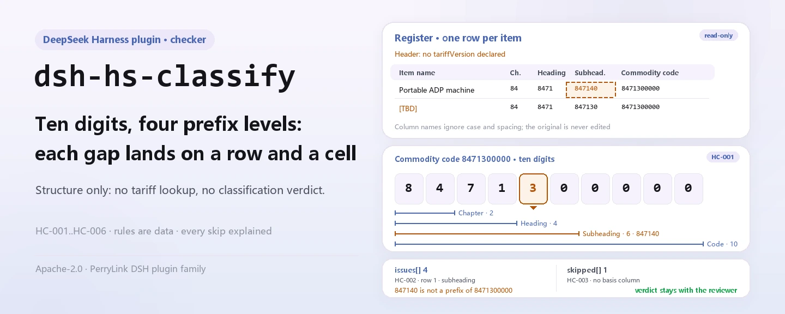

<div align="center">

<picture>
  <source media="(prefers-color-scheme: dark)" srcset="docs/assets/dsh-hs-classify-hero-en-dark.webp">
  
</picture>

# dsh-hs-classify

**Verifica un registro completo de clasificación de mercancías: qué fila, qué columna y qué difiere, una por una.**

Un verificador de DeepSeek Harness para declarantes y clasificadores de aduanas: solo comprueba la coherencia estructural de los códigos y los niveles — no modifica el original, no consulta el arancel y no emite un dictamen de clasificación.

[Instalar](#instalación-en-tres-pasos) · [Configuración](#configuración) · [FAQ](#faq) · [简体中文](README.md) · [English](README.en.md) · [Español](README.es.md) · [Português](README.pt.md) · [हिन्दी](README.hi.md)

[](LICENSE)
[](#compatibilidad)
[](https://www.npmjs.com/package/dsh-hs-classify)
[](https://github.com/PerryLink/dsh-hs-classify/actions/workflows/ci.yml)
[](#compatibilidad)

[](https://github.com/PerryLink/dsh-hs-classify/stargazers)
[](https://www.npmjs.com/package/dsh-hs-classify)
[](https://dshfind.com/plugins/PerryLink/dsh-hs-classify?ref=badge)
[](https://securityscorecards.dev/viewer/?uri=github.com/PerryLink/dsh-hs-classify)
[](https://dsh.market/)
[](https://gitee.com/perrylink/dsh-hs-classify)

```sh
dsh plugin --profile <name> add dsh-hs-classify
```

</div>

<sub>Plugin de la comunidad, no afiliado a DeepSeek. Repositorio canónico: <https://github.com/PerryLink/dsh-hs-classify> (Gitee es un espejo).</sub>

## Qué es

`dsh-hs-classify` lee un registro de clasificación de mercancías —la cabecera del declarante más una fila por partida— y comprueba la estructura de los números que registra: que el código de mercancía tenga diez dígitos, que el capítulo, la partida y la subpartida sean prefijos sucesivos de ese código, que los niveles vayan de lo general a lo específico, que cada fila registre una base de clasificación, que la cabecera declare la versión del arancel a la que pertenecen los códigos, que los números de ítem sean únicos en el registro y que no quede ningún marcador de plantilla sin sustituir en la denominación. Devuelve las diferencias como «qué fila, qué columna, qué difiere», y cada comprobación que no pudo ejecutarse aparece en `skipped` con su motivo. No modifica el original, no sube el material, no consulta el arancel y no decide en qué código deben clasificarse las mercancías.

<picture>
  <source media="(prefers-color-scheme: dark)" srcset="docs/assets/dsh-hs-classify-flow-v5-dark.svg">
  
</picture>

## Instalación en tres pasos

1. **Instala** (elige un canal):

   ```sh
   # canal npm (versiones publicadas)
   dsh plugin --profile web add dsh-hs-classify
   # canal git (último main)
   dsh plugin --profile web add github:PerryLink/dsh-hs-classify
   # canal tarball: pnpm pack en este repo y luego
   dsh plugin --profile web add ./dsh-hs-classify-<version>.tgz
   ```

   Los canales npm y tarball instalan artefactos ya construidos; el canal git ejecuta el script `prepare` del repositorio (tsdown) para generar `lib/`.

2. **Configuración mínima** (los valores por defecto ya funcionan; la fila entera puede omitirse):

   ```yaml
   - insert:
       - id: dsh-hs-classify
         name: dsh-hs-classify
         config:
           rulesFile: rules/hs-classify.yaml
   ```

   Todos los ajustes están en [Configuración](#configuración); el paquete de reglas es un archivo de datos, así que sustituir `rules/hs-classify.yaml` cambia el conjunto de reglas.

3. **Comprueba que se monta**:

   ```sh
   dsh --profile web --dump-config | grep 'dsh-hs-classify'
   node samples/quickstart/run.mjs
   ```

   ```text
   hs_classify: 2 issue(s) — error 0, warn 2, info 0
   skipped: 0
   ```

   La entrada del ejemplo está en `samples/quickstart/input/`, el resultado esperado en `samples/quickstart/expected/result.json` y la captura de la primera ejecución en [`docs/assets/quickstart.png`](docs/assets/quickstart.png).

**Desinstalar**: `dsh plugin --profile web remove dsh-hs-classify` (o borra la fila del patch del perfil).

## Capacidades clave

- **Seis reglas, cada hallazgo rastreable** — todo hallazgo lleva `ruleId`, fila y campo, el valor leído, la relación esperada y una indicación de revisión; la tabla de reglas viene después.
- **Diferencias, nunca dictámenes** — no declara cumplimiento ni responsabilidad, no sustituye al revisor; un guardián de redacción lo impone y todo informe lleva la advertencia.
- **Un resultado vacío no es un certificado de limpieza** — cada comprobación que no pudo ejecutarse aparece en `skipped` con su motivo: columna ausente, columna entera vacía, precondición no cumplida, regla desactivada.
- **El paquete de reglas es datos** — sustituir `rules/hs-classify.yaml` cambia el conjunto de reglas sin tocar TypeScript; el cargador valida los campos y los topes de severidad.
- **Solo local** — lee el archivo o el material en línea que le pasas; sin peticiones de red, sin telemetría, sin llamadas al modelo.

| Regla | Comprueba | Severidad | Tipo de base |
|---|---|---|---|
| `HC-001` | el código de mercancía tiene diez dígitos | warn | principle |
| `HC-002` | capítulo, partida y subpartida son prefijos sucesivos del código | warn | principle |
| `HC-003` | cada fila registra una base de clasificación | warn | direct |
| `HC-004` | la cabecera declara la versión del arancel | warn | principle |
| `HC-005` | los números de ítem son únicos en el registro | warn | principle |
| `HC-006` | la denominación no conserva marcadores sin sustituir | warn | principle |

## Qué responde

La tabla siguiente es el conjunto de ejemplos: la primera fila es el caso detallado y las demás son casos breves; las respuestas proceden del paquete de reglas y del comportamiento publicado.

#### Salida detallada

**Herramienta** `hs_classify`

**Entrada**

~~~json
{"rows":[{"品名":"便携式自动数据处理设备","子目":"847140","商品编号":"8471300000"}]}
~~~

**Salida**

~~~json
{
  "id": "dsh-hs-classify.HC-002.de09b5a6",
  "ruleId": "HC-002",
  "severity": "warn",
  "locator": {
    "field": "subheading",
    "row": 1
  },
  "found": "第 1 行「subheading」为「847140」，不是「hsCode」（8471300000）的前缀",
  "expected": "「subheading」应与「hsCode」的前几位一致",
  "fix": "核对层级填写；本条只核对前缀关系，不判断归类是否正确"
}
~~~

*Observed from `tests/fixtures/HC-002/HC-002-unsafe.json (cases.json expects HC-002 count 1); run via lib/index.mjs rules/hs-classify.yaml`*

| Usted pregunta | Qué responde |
|---|---|
| Algunos códigos del registro tienen ocho dígitos y uno termina en letra. ¿Se informa de ellos? | Sí. `HC-001` contrasta cada `hsCode` relleno con el `pattern` del paquete de reglas, `^[0-9]{10}$`, e informa de la fila junto con el valor que leyó. Solo comprueba el número de dígitos y los caracteres, nunca si la mercancía corresponde a ese código. Una celda de código vacía no se mira: lo que informa es un código con la forma incorrecta, no un código que falta. Los diez dígitos son un ajuste del paquete de reglas: cuando el arancel anual cambie la longitud, se edita el `pattern`, no el código. |
| El 章, el 品目 y el 子目 de una fila no concuerdan con su 商品编号. ¿Se detecta? | Sí. `HC-002` lee las columnas de nivel de lo general a lo específico —章, 品目 y 子目, dos, cuatro y seis dígitos en el ejemplo del propio paquete de reglas— e informa del nivel que no es prefijo del `hsCode` leído, o que no es más fino que el nivel anterior. Solo comprueba esa relación de prefijo y ese orden: si el código corresponde a la mercancía es una determinación aduanera que exige el arancel y las decisiones de clasificación, que este plugin no consulta. Una celda de nivel vacía no se compara. |
| Una fila deja vacía la 归类依据. | `HC-003` informa de esa fila: `basis` debe estar relleno en todas las filas que llevan la columna. Comprueba que haya algo escrito, no que la disposición arancelaria, la nota de capítulo, la decisión de clasificación o el dictamen anticipado citados existan o respalden la clasificación: este plugin no consulta nada de eso. Si el registro no tiene columna `basis`, `HC-003` aparece en `skipped` indicando que el material no tiene esa columna, en lugar de pasar en silencio. |
| La cabecera no dice a qué versión del arancel pertenecen los códigos. | `HC-004` exige que la cabecera declare `tariffVersion` e informa del registro cuando la deja vacía. Comprueba que la declaración esté presente, no que la edición nombrada sea la de estos códigos: la regla no lee los códigos, y los códigos se dividen y se fusionan entre ediciones. Su lista `fields` es un ajuste del paquete de reglas: añada `declarant` si su cabecera lo registra. |
| El 项号 5 aparece en dos filas. | `HC-005` informa de la fila posterior como duplicada de la anterior, porque `itemNo` debe ser único dentro de un mismo registro; la comparación ignora los espacios, así que `5` y ` 5 ` son el mismo número de ítem. Solo comprueba la unicidad. Una mercancía declarada en varias filas, por especificaciones distintas, necesita un número de ítem distinto en cada una. Aunque no haya ningún número repetido, `HC-005` no produce hallazgos ni aparece en `skipped`: la comprobación se ejecutó y no halló diferencias; solo una columna ausente o totalmente vacía la hace saltar. |
| La columna 品名 todavía tiene marcadores de plantilla. | `HC-006` informa de la fila y del marcador que encontró. El paquete de reglas busca 【, 】, {{, }}, XXX, xxx, 待填, 待补充, TBD, todo y 示例, y `terms` se puede recortar a su propia plantilla. Solo busca marcadores sin sustituir: no juzga si el nombre es correcto y tampoco exige que la columna esté rellena: una celda `description` vacía no le produce ningún hallazgo, y ninguna otra regla de este paquete la exige. |

## Configuración

Todos los parámetros ajustables son campos Schemastery de `src/config.ts`, por lo que se cambian desde `cordis.yml` sin tocar el código; los umbrales por regla están en el paquete de reglas bajo `rules/`.

| Clave | Tipo | Predeterminado | Descripción |
|---|---|---|---|
| `rulesFile` | string | `rules/hs-classify.yaml` | Ruta del paquete de reglas, relativa a la raíz del paquete |
| `disabledRules` | string[] | `[]` | Ids de reglas que se dejan de ejecutar; cada una aparece en `skipped` |
| `onlyRules` | string[] | `[]` | Ejecutar solo estas reglas; vacío ejecuta todas |
| `skipNotes` | string | `""` | Nota añadida a cada motivo de `skipped` |
| `timeoutMs` | number | `120000` | Presupuesto de tiempo de espera cooperativo de la herramienta, en milisegundos |

Ejemplo de sustitución en el patch del perfil:

```yaml
- insert:
    - id: dsh-hs-classify
      name: dsh-hs-classify
      config:
        onlyRules: [HC-001, HC-002]
        skipNotes: revisado con nuestras reglas internas
```

## Formato del material

La herramienta acepta JSON o YAML, como archivo (`file`) o texto en línea (`material`):

```yaml
declarant: 某某报关行
tariffVersion: 2026 年版税则
rows:
  - { 序号: '1', 品名: 便携式自动数据处理设备, 材质: 塑料外壳、金属结构件、电子元器件,
      功能: 数据处理与显示，重量 1.2 千克, 章: '84', 品目: '8471', 子目: '847130',
      商品编号: '8471300000', 申报日期: 2026-03-10,
      归类依据: 税则第八十四章章注及品目 8471 条文 }
```

Los nombres de columna se comparan sin distinguir mayúsculas y ignorando espacios, guiones bajos y guiones; se conservan los nombres propios del registro, así que un hallazgo nombra la columna que leyó. Los campos de cabecera y los alias de columna se declaran una sola vez en `src/model.ts`; el material debe traer al menos uno de `hsCode` / `description` / `chapter` / `heading`. Los campos son opcionales en la capa de lectura y los valida el motor, de modo que una exportación parcial produce hallazgos de «campo ausente» en lugar de un fallo.

## Origen de las reglas

| Documento | Número | Reglas que lo citan |
|---|---|---|
| 《中华人民共和国进出口税则》 | versión vigente no verificada en esta pasada | HC-001, HC-004, HC-005, HC-006 |
| 《商品名称及编码协调制度》 | versión vigente no verificada en esta pasada | HC-002 |
| 《中华人民共和国进出口关税条例》 | Decreto del Consejo de Estado n.º 392 (promulgado el 23-11-2003; revisado el 08-01-2011, el 07-12-2013 y el 06-02-2016) | HC-003 |

Los datos de las reglas están separados del código: `plugin`, `version`, `rules` y `disabled` viven en `rules/hs-classify.yaml`. Cada regla debe llevar `document` / `number` / `clause` / `excerpt` / `kind` / `source`, y el cargador impone que un `excerpt` sea una cita real de al menos ocho caracteres, y que una comprobación basada solo en un principio (`kind: derived-from-principle`, tope `warn`) o en una configuración institucional (`kind: institutional-configuration`, tope `info`) nunca se declare `error`. Un paquete que exagera su base falla al cargar en lugar de producir un informe con tono de autoridad.

**Parámetros del paquete de reglas** (se editan en `rules/hs-classify.yaml`, no en el código):

| Regla | Parámetro | Efecto |
|---|---|---|
| `HC-001` | `pattern` | la forma del código, `^[0-9]{10}$` por defecto; cámbielo si el arancel anual cambia la longitud |
| `HC-002` | `field` / `components` / `digits` | la columna del código, las columnas de nivel de lo general a lo específico (`[chapter, heading, subheading]`) y la longitud total esperada |
| `HC-004` | `fields` | campos de cabecera obligatorios; `[tariffVersion]` por defecto, añada `declarant` si su cabecera lo registra |
| `HC-006` | `terms` | la lista de marcadores que se buscan |

Los límites verificados y las conclusiones deliberadamente **no** afirmadas están en `rules/evidence/clause-verification-tariff-regulation.md`. **Solo 1 de las 6 reglas (`HC-003`) cita texto literal y está marcada `direct`**; las otras 5 dicen en el propio campo `excerpt` que el texto no se obtuvo y se quedan en `warn` o `info`. Donde una regla conserve esa nota, trátela como pista y no como cita; cuando tenga el texto, sustituya el `excerpt` y suba `kind` a `direct`. La suposición de diez dígitos es un `pattern` del paquete de reglas, así que un cambio anual del arancel exige editar el paquete, no el código.

## FAQ

<details>
<summary>¿Se sube el material o se guarda en otro sitio?</summary>

No. Es un verificador local: solo lee el contenido del archivo o el texto en línea que pasa a `hs_classify`, no hace peticiones de red, no incluye telemetría, analítica ni informes en segundo plano, y no escribe datos fuera del resultado de la herramienta y del almacenamiento de sesión/registros del propio host DSH. El host controla ese almacenamiento y su retención; este paquete no añade una segunda copia. Desinstalar el paquete no borra los registros de sesión del host ni los documentos que ya haya creado.

</details>

<details>
<summary>El informe está vacío, ¿significa que el registro está bien?</summary>

No. Una lista `issues` vacía significa que **las comprobaciones que se ejecutaron** no hallaron diferencias. Toda comprobación que no se ejecutó aparece en `skipped` con su motivo (columna ausente, columna entera vacía, precondición no cumplida, regla desactivada). Lea `skipped` antes que `issues`.

</details>

<details>
<summary>¿Compite con otros plugins DSH por nombres de herramienta, servicios o slots?</summary>

No. Registra una sola herramienta, `hs_classify`, no ofrece ninguna clave de servicio, no registra slots de cliente ni prefijo `webServer`, y el patch del bundle solo `insert`a su propia fila; el argumento punto por punto está en «Interoperabilidad con otros plugins DSH».

</details>

<details>
<summary>¿Cuánta sobrecarga de rendimiento supone?</summary>

Las comprobaciones son comparación local de cadenas y estructura: sin llamadas al modelo, sin peticiones de red, sin OCR ni reconocimiento de tablas. La herramienta declara un presupuesto cooperativo `timeoutMs` (por defecto `120000`) que quien llama puede abortar. El coste crece con el número de filas y de reglas; este repositorio no publica benchmark, así que no se afirma ninguna cifra en milisegundos.

</details>

<details>
<summary>El paquete de reglas no obtuvo el texto de las cláusulas, ¿sigue sirviendo?</summary>

Sí, pero hay que leerlo según su estado de evidencia. Una regla cuyo `excerpt` dice que el texto no se obtuvo se queda en `warn` / `info`, y el hallazgo nunca se presenta como cita; señala una diferencia literal entre el material y el paquete, no una conclusión jurídica. Para citar formalmente, obtenga primero el texto, sustituya el `excerpt` y suba `kind` a `direct`.

</details>

## Límites de seguridad

- **Comprueba la forma de un código, nunca si el código es correcto.** La clasificación es una determinación aduanera que depende del material, la función y el grado de elaboración de la mercancía, junto con las notas de sección y de capítulo del arancel y cualquier decisión de clasificación o dictamen anticipado. **Este plugin no consulta el arancel, no consulta decisiones de clasificación y no consulta dictámenes.**
- **Lo que puede y no puede encontrar.** **Puede** encontrar «el código de esta fila no concuerda con el capítulo, la partida y la subpartida que la misma fila declara»; **no puede** encontrar «el código de esta fila no corresponde a la mercancía», porque eso exige el arancel mismo.
- **Un código estructuralmente perfecto para la mercancía equivocada pasa.** Un registro con un código estructuralmente perfecto para la mercancía equivocada pasa este plugin; es el límite documentado, declarado en la cabecera del paquete, en la nota de `HC-002` y en el [`TROUBLESHOOTING.md`](TROUBLESHOOTING.md) incluido.
- **El estado de las citas se declara regla por regla.** 1 de las 6 reglas (`HC-003`) cita texto literal y está marcada `direct`; las otras 5 dicen en el propio campo `excerpt` que el texto no se obtuvo y se quedan en `warn` / `info`. Trate esas reglas como pistas, no como citas; obtenga el texto y luego sustituya el `excerpt` y suba `kind`.
- **Un resultado vacío no es un certificado de limpieza.** Toda comprobación que no pudo ejecutarse aparece en `skipped` con su motivo; una lista `issues` vacía solo cubre las comprobaciones ejecutadas.
- **Sin lenguaje que dictamine.** El informe no se pronuncia sobre cumplimiento, responsabilidad ni corrección de la clasificación; un guardián de redacción lo impone y todo informe lleva la advertencia.
- **Solo local.** Solo lee el archivo o el material en línea que pasa a la herramienta; sin peticiones de red, sin telemetría, sin llamadas al modelo; no escribe nada fuera del resultado de la herramienta y del almacenamiento de sesión/registros del host.

## Limitaciones conocidas

- **El alcance son exactamente seis comprobaciones estructurales.** Código de diez dígitos, prefijos de nivel, base registrada, versión del arancel declarada, unicidad de números de ítem y marcadores en la denominación; cualquier otra comparación (por ejemplo, si la mercancía encaja en un código) queda fuera de este plugin.
- **Las celdas vacías y las columnas ausentes se tratan de forma explícita.** Una celda de código vacía no dispara `HC-001`; una celda de nivel vacía no se compara en `HC-002`; `HC-003` salta cuando la columna `basis` existe pero una celda está vacía, y se lista en `skipped` cuando toda la columna falta; si todos los números de ítem son distintos, `HC-005` pasa sin entrada en `skipped`.
- **`HC-002` solo comprueba la relación de prefijo y el aumento de longitud.** El capítulo son los 2 primeros dígitos, la partida los 4 primeros, la subpartida los 6 primeros; si el código corresponde a la mercancía exige el arancel y las decisiones de clasificación, que este plugin no consulta.
- **`HC-004` solo comprueba que la declaración exista.** No juzga si la edición nombrada es la de estos códigos; los códigos se dividen y se fusionan entre ediciones anuales, así que ese juicio requiere una persona.
- **Cinco reglas siguen llevando marcadores de cita honestos.** `HC-001`, `HC-002`, `HC-004`, `HC-005` y `HC-006` dicen en `excerpt` que el texto del arancel o del sistema armonizado no se obtuvo; se quedan en `warn` y el informe declara esa laguna.
- **El material debe ser JSON o YAML.** Los archivos Excel, Word y PDF deben convertirse antes a texto estructurado (puede hacerse en el chat); la herramienta no hace OCR ni analiza tablas binarias.
- **El texto del informe y de las indicaciones está actualmente en chino.** El `note` del paquete, los mensajes de diferencia y la advertencia están en chino; los nombres de columna siguen su propio material, así que los hallazgos llevan los nombres de columna de su registro.

## Interoperabilidad con otros plugins DSH

Por el código y el manifiesto, este plugin no introduce colisiones de nombre de herramienta, clave de servicio, slot, ruta HTTP ni capa de patch:

- **Superficie de herramientas**: registra una sola herramienta, `hs_classify`, y ninguna segunda herramienta ni cara de cliente.
- **Clave de servicio**: `inject: ['tools']` solo consume el servicio `tools` y no proporciona ninguna clave de servicio.
- **Slots**: no hay directorio `client/` ni se registra ninguna clave de slot de cliente.
- **Rutas HTTP**: ningún prefijo `webServer` y ninguna ruta nueva.
- **Capa de patch**: `cordis.patch.yml` solo `insert`a su propia fila y nunca sobrescribe el `config` de una fila integrada.
- **Globales y red**: no parchea prototipos, no reescribe `process.env` ni sustituye el fetch global; sin peticiones de red, sin llamadas al modelo.

Las `capabilities` del manifiesto son solo `tools:register`; `dsh.demo` declara `network: false` y `writes: []`.

## Compatibilidad

| Superficie | Estado |
|---|---|
| Harness | Rango de peers `>=0.1.2-rc.1 <0.2.0 \|\| >=0.2.0-0 <0.3.0` — verificado para aceptar tanto `0.2.0-rc.2` como `0.2.1-rc.2`. **`engines.dsh` se declara como `>=0.2.1-0 <0.3.0`** y el host lo aplica desde 0.2.1 |
| Node | `^22.19.0 \|\| >=24.0.0` |
| Plataformas | Todas (ESM puro; sin código nativo, sin red, sin llamada al modelo) |
| Modo de herramienta | Funciona en `native` y `ptc`; para verificar varios materiales en lote use `ptc`, que paga el coste del schema una sola vez |

## Ecosistema y calidad

- [Espejo en Gitee](https://gitee.com/perrylink/dsh-hs-classify) (espejo sincronizado; GitHub es el canónico)
- [Página de dshfind](https://dshfind.com/plugins/PerryLink/dsh-hs-classify) (instalaciones y ranking)
- [Informe OpenSSF Scorecard](https://securityscorecards.dev/viewer/?uri=github.com/PerryLink/dsh-hs-classify) (impulsado por [.github/workflows/scorecard.yml](.github/workflows/scorecard.yml))
- [DSH Market](https://dsh.market/) (publicado)
- [Base de conocimiento del ecosistema](https://perrylink.github.io/dsh-plugin-guide/): guía de desarrollo de plugins · datos de selección · criterios de mantenimiento

## Desarrollo

```sh
pnpm install
pnpm run typecheck
pnpm test
pnpm run build
pnpm run verify:self-contained
pnpm run check:lockfile
pnpm run check:readmes
pnpm run check:citations
node samples/quickstart/run.mjs
```

`prepublishOnly` vuelve a ejecutar la puerta, así que una release no puede publicar un árbol sin construir o desviado. Estructura:

| Ruta | Función |
|---|---|
| `src/index.ts` | contrato function-plugin: `name` / `inject` / `Config` / `apply`, registra `hs_classify` y resuelve el paquete de reglas |
| `src/config.ts` | esquema Schemastery; todos los ajustes viven aquí |
| `src/model.ts` | forma de la tabla y contrato del material (alias de columnas, alias de cabecera, campos requeridos) |
| `src/view.ts` | proyección del informe para el modelo; `output.schema` la refleja |
| `src/shared/` | motor de comprobación compartido, cargador del paquete de reglas, subconjunto YAML, forma del informe y guardián de redacción |
| `rules/hs-classify.yaml` | el paquete de reglas, 6 reglas |
| `rules/evidence/` | el registro de verificación de cada cita |
| `tests/` | vitest; cada regla tiene un fixture conforme y otro infractor |
| `samples/quickstart/` | la muestra mínima reejecutable y su resultado esperado |
| `scripts/` | scripts de puerta y el generador de imágenes |

Las imágenes del README se generan programáticamente con [`scripts/gen-readme-assets.py`](scripts/gen-readme-assets.py) (Pillow para las bandas hero, SVG escrito a mano para el diagrama de estructura; ejecute `python scripts/gen-readme-assets.py`), que produce `docs/assets/dsh-hs-classify-hero-{zh,en}-{light,dark}.webp` y `docs/assets/dsh-hs-classify-flow-v5-{light,dark}.svg`. Los antiguos diagramas de flujo se conservan en `docs/assets/` para que los enlaces externos sigan resolviendo. Este repositorio no tiene datos de benchmark, así que no se dibuja gráfico de evidencia.

Topics: `deepseek-harness`, `dsh`, `dsh-plugin`, `cordis`, `classify`

## Familia y agradecimientos

Este proyecto forma parte de la familia de plugins de DeepSeek Harness de [PerryLink](https://github.com/PerryLink) (todos Apache-2.0). Si le resulta útil, **una estrella ayuda a que la siguiente persona lo encuentre** — no desbloquea ninguna función.

- [@PerryLink](https://github.com/PerryLink) — creador y mantenedor: el esquema de tabla, el motor de comprobación, el paquete de reglas y la documentación en cinco idiomas.

<details>
<summary>Expandir todos los plugins</summary>

| Plugin | Estado |
|---|---|
| **[dsh-aqua-input-check](https://github.com/PerryLink/dsh-aqua-input-check)** |  |
| **[dsh-archive-check](https://github.com/PerryLink/dsh-archive-check)** |  |
| **[dsh-auto-review](https://github.com/PerryLink/dsh-auto-review)** |  |
| **[dsh-autotier](https://github.com/PerryLink/dsh-autotier)** | 🧊 CONGELADO — ver el README del repo |
| **[dsh-bid-ca-precheck](https://github.com/PerryLink/dsh-bid-ca-precheck)** |  |
| **[dsh-bid-qual-check](https://github.com/PerryLink/dsh-bid-qual-check)** |  |
| **[dsh-cert-mcp](https://github.com/PerryLink/dsh-cert-mcp)** | 🧊 CONGELADO — ver el README del repo |
| **[dsh-checkpoint-rewind](https://github.com/PerryLink/dsh-checkpoint-rewind)** |  |
| **[dsh-click](https://github.com/PerryLink/dsh-click)** |  |
| **[dsh-composer-history](https://github.com/PerryLink/dsh-composer-history)** |  |
| **[dsh-contract-stance](https://github.com/PerryLink/dsh-contract-stance)** |  |
| **[dsh-customs-doc-check](https://github.com/PerryLink/dsh-customs-doc-check)** |  |
| **[dsh-data-quality](https://github.com/PerryLink/dsh-data-quality)** |  |
| **[dsh-demurrage-ledger](https://github.com/PerryLink/dsh-demurrage-ledger)** |  |
| **[dsh-doublecheck](https://github.com/PerryLink/dsh-doublecheck)** |  |
| **[dsh-drill-script-check](https://github.com/PerryLink/dsh-drill-script-check)** |  |
| **[dsh-eia-guide-check](https://github.com/PerryLink/dsh-eia-guide-check)** |  |
| **[dsh-emergency-plan](https://github.com/PerryLink/dsh-emergency-plan)** |  |
| **[dsh-essay-rubric-check](https://github.com/PerryLink/dsh-essay-rubric-check)** |  |
| **[dsh-evidence-check](https://github.com/PerryLink/dsh-evidence-check)** |  |
| **[dsh-export-ctl-check](https://github.com/PerryLink/dsh-export-ctl-check)** |  |
| **[dsh-fast](https://github.com/PerryLink/dsh-fast)** |  |
| **[dsh-fmea-table-check](https://github.com/PerryLink/dsh-fmea-table-check)** |  |
| **[dsh-forecast-penalty](https://github.com/PerryLink/dsh-forecast-penalty)** |  |
| **[dsh-fund-research](https://github.com/PerryLink/dsh-fund-research)** |  |
| **[dsh-github](https://github.com/PerryLink/dsh-github)** |  |
| **[dsh-gongwen-flow-check](https://github.com/PerryLink/dsh-gongwen-flow-check)** |  |
| **[dsh-gongwen-word-check](https://github.com/PerryLink/dsh-gongwen-word-check)** |  |
| **[dsh-guard-plan-qc](https://github.com/PerryLink/dsh-guard-plan-qc)** |  |
| **[dsh-hazchem-check](https://github.com/PerryLink/dsh-hazchem-check)** |  |
| **[dsh-hazplan-check](https://github.com/PerryLink/dsh-hazplan-check)** |  |
| **[dsh-hidden-risk-map](https://github.com/PerryLink/dsh-hidden-risk-map)** |  |
| **[dsh-hs-classify](https://github.com/PerryLink/dsh-hs-classify)** |  |
| **[dsh-icd-rule-check](https://github.com/PerryLink/dsh-icd-rule-check)** |  |
| **[dsh-industry-research](https://github.com/PerryLink/dsh-industry-research)** |  |
| **[dsh-lawcite-adapter](https://github.com/PerryLink/dsh-lawcite-adapter)** |  |
| **[dsh-laya](https://github.com/PerryLink/dsh-laya)** |  |
| **[dsh-lc-doc-check](https://github.com/PerryLink/dsh-lc-doc-check)** |  |
| **[dsh-learning-gap-check](https://github.com/PerryLink/dsh-learning-gap-check)** |  |
| **[dsh-library](https://github.com/PerryLink/dsh-library)** |  |
| **[dsh-local-ai](https://github.com/PerryLink/dsh-local-ai)** |  |
| **[dsh-lsp-actions](https://github.com/PerryLink/dsh-lsp-actions)** |  |
| **[dsh-mask](https://github.com/PerryLink/dsh-mask)** |  |
| **[dsh-mcp-panel](https://github.com/PerryLink/dsh-mcp-panel)** |  |
| **[dsh-medrec-qc](https://github.com/PerryLink/dsh-medrec-qc)** |  |
| **[dsh-memento](https://github.com/PerryLink/dsh-memento)** |  |
| **[dsh-nsfc-form-check](https://github.com/PerryLink/dsh-nsfc-form-check)** |  |
| **[dsh-nurse-record-check](https://github.com/PerryLink/dsh-nurse-record-check)** |  |
| **[dsh-observe](https://github.com/PerryLink/dsh-observe)** |  |
| **[dsh-origin-rvc-check](https://github.com/PerryLink/dsh-origin-rvc-check)** |  |
| **[dsh-ota-review-check](https://github.com/PerryLink/dsh-ota-review-check)** |  |
| **[dsh-output-styles](https://github.com/PerryLink/dsh-output-styles)** |  |
| **[dsh-paper-doc-adapter](https://github.com/PerryLink/dsh-paper-doc-adapter)** |  |
| **[dsh-permission-rules](https://github.com/PerryLink/dsh-permission-rules)** |  |
| **[dsh-permit-report-check](https://github.com/PerryLink/dsh-permit-report-check)** |  |
| **[dsh-pipeline-check](https://github.com/PerryLink/dsh-pipeline-check)** |  |
| **[dsh-pleading-draft](https://github.com/PerryLink/dsh-pleading-draft)** |  |
| **[dsh-plugin-doctor](https://github.com/PerryLink/dsh-plugin-doctor)** | 🚫 RETIRADO (repo archivado) |
| **[dsh-plugin-guide](https://github.com/PerryLink/dsh-plugin-guide)** |  |
| **[dsh-plugin-kit](https://github.com/PerryLink/dsh-plugin-kit)** | 🚫 RETIRADO (repo archivado) |
| **[dsh-plugin-upgrade](https://github.com/PerryLink/dsh-plugin-upgrade)** | 🚫 RETIRADO (repo archivado) |
| **[dsh-policy-brief-draft](https://github.com/PerryLink/dsh-policy-brief-draft)** |  |
| **[dsh-power-loss-split](https://github.com/PerryLink/dsh-power-loss-split)** |  |
| **[dsh-power-ticket-check](https://github.com/PerryLink/dsh-power-ticket-check)** |  |
| **[dsh-ppap-check](https://github.com/PerryLink/dsh-ppap-check)** |  |
| **[dsh-protest-deadline](https://github.com/PerryLink/dsh-protest-deadline)** |  |
| **[dsh-railway-window](https://github.com/PerryLink/dsh-railway-window)** |  |
| **[dsh-repair-order-qc](https://github.com/PerryLink/dsh-repair-order-qc)** |  |
| **[dsh-research-report](https://github.com/PerryLink/dsh-research-report)** |  |
| **[dsh-review-reply-check](https://github.com/PerryLink/dsh-review-reply-check)** |  |
| **[dsh-rulefile-check](https://github.com/PerryLink/dsh-rulefile-check)** |  |
| **[dsh-safety-brief-check](https://github.com/PerryLink/dsh-safety-brief-check)** |  |
| **[dsh-score](https://github.com/PerryLink/dsh-score)** |  |
| **[dsh-session-sync](https://github.com/PerryLink/dsh-session-sync)** |  |
| **[dsh-site-log-check](https://github.com/PerryLink/dsh-site-log-check)** |  |
| **[dsh-skill-pack-security](https://github.com/PerryLink/dsh-skill-pack-security)** |  |
| **[dsh-soe-decision-check](https://github.com/PerryLink/dsh-soe-decision-check)** |  |
| **[dsh-soilwater-check](https://github.com/PerryLink/dsh-soilwater-check)** |  |
| **[dsh-sop-sync-check](https://github.com/PerryLink/dsh-sop-sync-check)** |  |
| **[dsh-spc-gbt-adapter](https://github.com/PerryLink/dsh-spc-gbt-adapter)** |  |
| **[dsh-talk](https://github.com/PerryLink/dsh-talk)** |  |
| **[dsh-tender-extract](https://github.com/PerryLink/dsh-tender-extract)** |  |
| **[dsh-tender-matrix](https://github.com/PerryLink/dsh-tender-matrix)** |  |
| **[dsh-test-drive](https://github.com/PerryLink/dsh-test-drive)** |  |
| **[dsh-ticktick](https://github.com/PerryLink/dsh-ticktick)** | 🚫 RETIRADO (repo archivado) |
| **[dsh-translate](https://github.com/PerryLink/dsh-translate)** |  |
| **[dsh-warranty-calc](https://github.com/PerryLink/dsh-warranty-calc)** |  |
| **[dsh-budget](https://github.com/PerryLink/dsh-budget)** | 🧊 CONGELADO — ver el README del repo |
| **[dsh-claude-move](https://github.com/PerryLink/dsh-claude-move)** | 🧊 CONGELADO — ver el README del repo |
| **[dsh-defend](https://github.com/PerryLink/dsh-defend)** | 🧊 CONGELADO — ver el README del repo |
| **[dsh-draw](https://github.com/PerryLink/dsh-draw)** | 🧊 CONGELADO — ver el README del repo |
| **[dsh-reach](https://github.com/PerryLink/dsh-reach)** | 🧊 CONGELADO — ver el README del repo |
| **[dsh-background-agents](https://github.com/PerryLink/dsh-background-agents)** | 🚫 RETIRADO (repo archivado) |
| **[dsh-session-pin](https://github.com/PerryLink/dsh-session-pin)** | 🚫 RETIRADO (repo archivado) |
| **[dsh-team-rooms](https://github.com/PerryLink/dsh-team-rooms)** | 🚫 RETIRADO (repo archivado) |

</details>

## Licencia

[LICENSE](LICENSE) (Apache License 2.0) © 2026 dsh-hs-classify contributors

<p align="center"><sub>Apache-2.0 · Plugin de la comunidad, no afiliado a DeepSeek.</sub></p>
