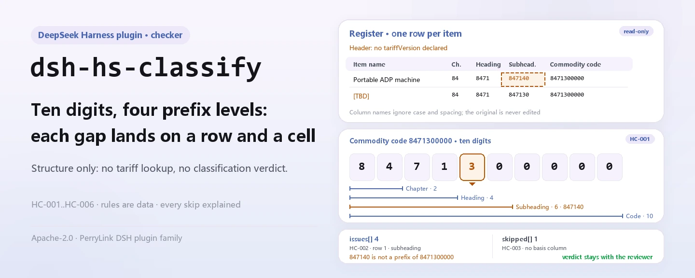
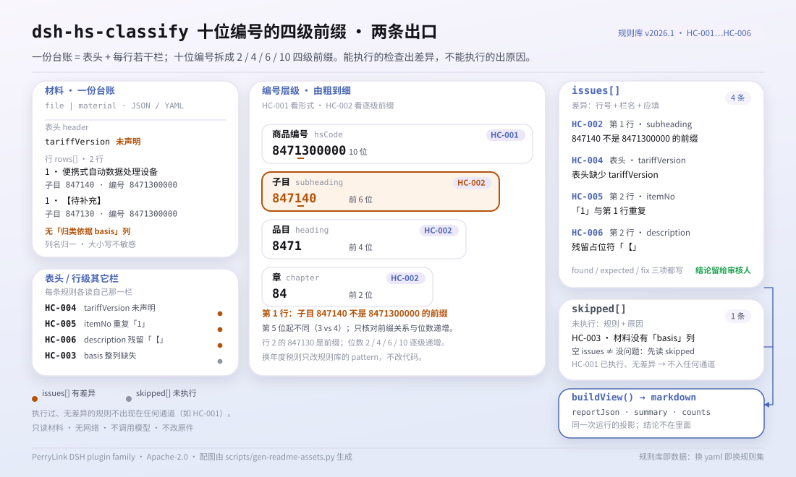

<div align="center">

<picture>
  <source media="(prefers-color-scheme: dark)" srcset="docs/assets/dsh-hs-classify-hero-en-dark.webp">
  
</picture>

# dsh-hs-classify

**पूरा माल-वर्गीकरण रजिस्टर एक बार जाँचें: कौन-सी पंक्ति, कौन-सा कॉलम, क्या अंतर है — एक-एक करके।**

कस्टम्स घोषणाकर्ताओं और वर्गीकरणकर्ताओं के लिए DeepSeek Harness प्लगइन: यह केवल कोड और स्तरों की संरचनात्मक संगति जाँचता है — मूल नहीं बदलता, टैरिफ़ नहीं देखता और वर्गीकरण पर कोई निर्णय नहीं देता।

[इंस्टॉल](#तीन-चरणों-में-शुरुआत) · [कॉन्फ़िगरेशन](#कॉन्फ़िगरेशन) · [FAQ](#faq) · [简体中文](README.md) · [English](README.en.md) · [Español](README.es.md) · [Português](README.pt.md) · [हिन्दी](README.hi.md)

[](LICENSE)
[](#संगतता)
[](https://www.npmjs.com/package/dsh-hs-classify)
[](https://github.com/PerryLink/dsh-hs-classify/actions/workflows/ci.yml)
[](#संगतता)

[](https://github.com/PerryLink/dsh-hs-classify/stargazers)
[](https://www.npmjs.com/package/dsh-hs-classify)
[](https://dshfind.com/plugins/PerryLink/dsh-hs-classify?ref=badge)
[](https://securityscorecards.dev/viewer/?uri=github.com/PerryLink/dsh-hs-classify)
[](https://dsh.market/)
[](https://gitee.com/perrylink/dsh-hs-classify)

```sh
dsh plugin --profile <name> add dsh-hs-classify
```

</div>

<sub>सामुदायिक प्लगइन, DeepSeek से असंबद्ध। कैनोनिकल रिपॉज़िटरी: <https://github.com/PerryLink/dsh-hs-classify> (Gitee एक मिरर है)।</sub>

## यह क्या है

`dsh-hs-classify` एक वर्गीकरण रजिस्टर — घोषणाकर्ता का हेडर और प्रत्येक मद की एक पंक्ति — पढ़ता है और उसमें दर्ज संख्याओं की संरचना की जाँच करता है: क्या माल-कोड दस अंकों का है, क्या उसका अध्याय, हेडिंग और उप-हेडिंग उस कोड के क्रमिक पूर्व-खंड हैं, क्या स्तर मोटे से बारीक की ओर जाते हैं, क्या हर पंक्ति में वर्गीकरण का आधार दर्ज है, क्या हेडर उस टैरिफ़ संस्करण की घोषणा करता है जिससे ये कोड संबंधित हैं, क्या मद-क्रमांक रजिस्टर में अद्वितीय हैं, और क्या मद के नाम में कोई बदला न गया प्लेसहोल्डर शेष है। यह अंतरों को «कौन-सी पंक्ति, कौन-सा कॉलम, क्या अंतर» के रूप में लौटाता है, और हर वह जाँच जो नहीं चल सकी, कारण के साथ `skipped` में आती है। यह मूल को नहीं बदलता, सामग्री अपलोड नहीं करता, टैरिफ़ नहीं देखता और यह निर्णय नहीं देता कि माल किस कोड में वर्गीकृत होना चाहिए।

<picture>
  <source media="(prefers-color-scheme: dark)" srcset="docs/assets/dsh-hs-classify-flow-v5-dark.svg">
  
</picture>

## तीन चरणों में शुरुआत

1. **इंस्टॉल करें** (एक चैनल चुनें):

   ```sh
   # npm चैनल (प्रकाशित रिलीज़)
   dsh plugin --profile web add dsh-hs-classify
   # git चैनल (नवीनतम main)
   dsh plugin --profile web add github:PerryLink/dsh-hs-classify
   # tarball चैनल: इस रेपो में pnpm pack करके
   dsh plugin --profile web add ./dsh-hs-classify-<version>.tgz
   ```

   npm और tarball चैनल पहले से बने आर्टिफ़ैक्ट इंस्टॉल करते हैं; git चैनल `lib/` बनाने के लिए रेपो का `prepare` स्क्रिप्ट (tsdown) चलाता है।

2. **न्यूनतम कॉन्फ़िग** (डिफ़ॉल्ट से ही चलता है; पूरी पंक्ति छोड़ी जा सकती है):

   ```yaml
   - insert:
       - id: dsh-hs-classify
         name: dsh-hs-classify
         config:
           rulesFile: rules/hs-classify.yaml
   ```

   सभी समायोज्य [कॉन्फ़िगरेशन](#कॉन्फ़िगरेशन) में हैं; नियम-पैक स्वयं एक डेटा फ़ाइल है, इसलिए `rules/hs-classify.yaml` बदलने से नियम-समुच्चय बदल जाता है।

3. **माउंट होने की पुष्टि करें**:

   ```sh
   dsh --profile web --dump-config | grep 'dsh-hs-classify'
   node samples/quickstart/run.mjs
   ```

   ```text
   hs_classify: 2 issue(s) — error 0, warn 2, info 0
   skipped: 0
   ```

   नमूना इनपुट `samples/quickstart/input/` में, अपेक्षित परिणाम `samples/quickstart/expected/result.json` में और पहली बार चलाने का स्क्रीनशॉट [`docs/assets/quickstart.png`](docs/assets/quickstart.png) में है।

**अनइंस्टॉल**: `dsh plugin --profile web remove dsh-hs-classify` (या प्रोफ़ाइल patch से वह पंक्ति हटा दें)।

## मुख्य क्षमताएँ

- **छह नियम, हर निष्कर्ष का स्रोत स्पष्ट** — हर निष्कर्ष में `ruleId`, पंक्ति और फ़ील्ड, पढ़ा गया मान, अपेक्षित संबंध और समीक्षा संकेत होता है; नियम-तालिका नीचे है।
- **अंतर, कभी निर्णय नहीं** — अनुपालन या दायित्व का निर्णय नहीं, समीक्षक का विकल्प नहीं; शब्द-रक्षक इसे लागू करता है और हर रिपोर्ट में अस्वीकरण रहता है।
- **खाली परिणाम का अर्थ «सब ठीक» नहीं** — हर वह जाँच जो नहीं चल सकी, कारण के साथ `skipped` में आती है: कॉलम अनुपस्थित, पूरा कॉलम खाली, पूर्व-शर्त पूरी नहीं, नियम बंद।
- **नियम-पैक डेटा है** — TypeScript बदले बिना `rules/hs-classify.yaml` बदलकर नियम-समुच्चय बदलें; लोडर फ़ील्ड और गंभीरता-सीमाएँ जाँचता है।
- **केवल स्थानीय** — यह आपके द्वारा दी गई फ़ाइल या इनलाइन सामग्री पढ़ता है; कोई नेटवर्क अनुरोध, टेलीमेट्री या मॉडल कॉल नहीं।

| नियम | क्या जाँचता है | गंभीरता | आधार-प्रकार |
|---|---|---|---|
| `HC-001` | माल-कोड दस अंकों का है | warn | principle |
| `HC-002` | अध्याय, हेडिंग और उप-हेडिंग कोड के क्रमिक पूर्व-खंड हैं | warn | principle |
| `HC-003` | हर पंक्ति में वर्गीकरण का आधार दर्ज है | warn | direct |
| `HC-004` | हेडर टैरिफ़ संस्करण घोषित करता है | warn | principle |
| `HC-005` | मद-क्रमांक रजिस्टर में अद्वितीय हैं | warn | principle |
| `HC-006` | नाम में बदला न गया प्लेसहोल्डर नहीं है | warn | principle |

## यह किन सवालों का जवाब देता है

नीचे दी गई तालिका उदाहरण-समुच्चय है: पहली पंक्ति विस्तृत केस है, बाकी संक्षिप्त केस हैं; उत्तर नियम-पैक और प्रकाशित जाँच-व्यवहार से आते हैं।

#### विस्तृत आउटपुट

**उपकरण** `hs_classify`

**इनपुट**

~~~json
{"rows":[{"品名":"便携式自动数据处理设备","子目":"847140","商品编号":"8471300000"}]}
~~~

**आउटपुट**

~~~json
{
  "id": "dsh-hs-classify.HC-002.de09b5a6",
  "ruleId": "HC-002",
  "severity": "warn",
  "locator": {
    "field": "subheading",
    "row": 1
  },
  "found": "第 1 行「subheading」为「847140」，不是「hsCode」（8471300000）的前缀",
  "expected": "「subheading」应与「hsCode」的前几位一致",
  "fix": "核对层级填写；本条只核对前缀关系，不判断归类是否正确"
}
~~~

*Observed from `tests/fixtures/HC-002/HC-002-unsafe.json (cases.json expects HC-002 count 1); run via lib/index.mjs rules/hs-classify.yaml`*

| आपका सवाल | इसका जवाब |
|---|---|
| हमारे रजिस्टर में कुछ कोड आठ अंकों के हैं और एक के अंत में अक्षर है। क्या ये दर्ज होंगे? | हाँ। `HC-001` हर भरे हुए `hsCode` की तुलना नियम-पैक के `pattern` (`^[0-9]{10}$`) से करता है और उस पंक्ति को उस मान के साथ दर्ज करता है जो उसने पढ़ा। यह केवल अंकों की संख्या और अक्षरों की जाँच करता है, यह कभी नहीं कि माल उसी कोड के अंतर्गत आता है। खाली कोड सेल छोड़ दिया जाता है, इसलिए यह गलत आकार के कोड को दर्ज करता है, अनुपस्थित कोड को नहीं। दस अंक नियम-पैक की सेटिंग है: वार्षिक टैरिफ़ से लंबाई बदले तो `pattern` बदलें, कोड नहीं। |
| किसी पंक्ति के 章, 品目 और 子目 उसके 商品编号 से मेल नहीं खाते। क्या यह पकड़ में आता है? | हाँ। `HC-002` स्तर-कॉलमों को मोटे से बारीक क्रम में पढ़ता है — 章, 品目, 子目, नियम-पैक के अपने उदाहरण में दो, चार और छह अंक — और वह स्तर दर्ज करता है जो पढ़े गए `hsCode` का पूर्व-खंड (prefix) नहीं है, या जो अपने पिछले स्तर से अधिक बारीक नहीं है। यह केवल उस पूर्व-खंड संबंध और उस क्रम की जाँच करता है: कोड उस माल पर लागू होता है या नहीं, यह सीमा-शुल्क का निर्णय है जिसके लिए टैरिफ़ और वर्गीकरण निर्णय चाहिए, जिन्हें यह प्लगइन नहीं देखता। खाली छोड़ा गया स्तर-कॉलम तुलना में नहीं आता। |
| एक पंक्ति में 归类依据 खाली है। | `HC-003` उस पंक्ति को दर्ज करता है: जिन पंक्तियों में यह कॉलम है, उनमें `basis` भरा होना चाहिए। यह देखता है कि कुछ लिखा है या नहीं, यह नहीं कि उद्धृत टैरिफ़ प्रावधान, अध्याय-टिप्पणी, वर्गीकरण निर्णय या अग्रिम निर्णय मौजूद है या उस वर्गीकरण का समर्थन करता है — यह प्लगइन इनमें से कुछ भी नहीं देखता। यदि रजिस्टर में `basis` कॉलम ही न हो, तो `HC-003` चुपचाप पास होने के बजाय `skipped` में यह बताते हुए आता है कि सामग्री में वह कॉलम नहीं है। |
| हेडर यह नहीं बताता कि कोड टैरिफ़ के किस संस्करण के हैं। | `HC-004` अपेक्षा करता है कि हेडर `tariffVersion` घोषित करे, और हेडर में वह खाली होने पर रजिस्टर को दर्ज करता है। यह देखता है कि घोषणा मौजूद है, यह नहीं कि बताया गया संस्करण इन्हीं कोड का है: यह नियम कोड नहीं पढ़ता, और संस्करणों के बीच कोड बँटते और जुड़ते हैं। इसकी `fields` सूची नियम-पैक की सेटिंग है: हेडर में घोषणाकर्ता भी दर्ज हो तो `declarant` जोड़ दें। |
| 项号 5 दो पंक्तियों में आया है। | `HC-005` बाद वाली पंक्ति को पहली की दोहराई हुई बताता है, क्योंकि एक ही रजिस्टर में `itemNo` अद्वितीय होना चाहिए; तुलना में खाली जगह नहीं गिनी जाती, इसलिए `5` और ` 5 ` एक ही मद-क्रमांक हैं। यह केवल अद्वितीयता की जाँच करता है। एक ही माल कई पंक्तियों में (जैसे भिन्न विशिष्टताओं के साथ) घोषित हो तो हर पंक्ति में अलग मद-क्रमांक चाहिए। सारे क्रमांक अलग होने पर `HC-005` कोई निष्कर्ष नहीं देता और `skipped` में भी नहीं आता: जाँच चली और कोई अंतर नहीं मिला; केवल कॉलम अनुपस्थित या पूरा खाली होने पर ही वह `skipped` में आता है। |
| 品名 कॉलम में अब भी टेम्पलेट के प्लेसहोल्डर पड़े हैं। | `HC-006` उस पंक्ति और मिले हुए प्लेसहोल्डर को दर्ज करता है। नियम-पैक 【, 】, {{, }}, XXX, xxx, 待填, 待补充, TBD, todo और 示例 खोजता है, और `terms` को अपने टेम्पलेट के अनुसार घटाया-बढ़ाया जा सकता है। यह केवल बदले न गए प्लेसहोल्डर खोजता है: यह नहीं आँकता कि नाम सही है, और यह भी नहीं माँगता कि कॉलम भरा हो — खाली `description` सेल से इसका कोई अंतर दर्ज नहीं होता, और इस नियम-पैक का कोई अन्य नियम भी इसे नहीं माँगता। |

## कॉन्फ़िगरेशन

सभी समायोज्य पैरामीटर `src/config.ts` की Schemastery स्कीमा में हैं, इसलिए कोड बदले बिना `cordis.yml` से बदले जा सकते हैं; प्रति-नियम सीमाएँ `rules/` के नियम-पैक में हैं।

| कुंजी | प्रकार | डिफ़ॉल्ट | विवरण |
|---|---|---|---|
| `rulesFile` | string | `rules/hs-classify.yaml` | नियम-पैक का पथ, पैकेज रूट के सापेक्ष |
| `disabledRules` | string[] | `[]` | बंद करने वाले नियम id; प्रत्येक `skipped` में दिखता है |
| `onlyRules` | string[] | `[]` | केवल ये नियम चलाएँ; खाली होने पर सभी नियम चलते हैं |
| `skipNotes` | string | `""` | हर `skipped` कारण के आगे जोड़ी जाने वाली टिप्पणी |
| `timeoutMs` | number | `120000` | उपकरण का सहकारी समय-सीमा बजट (मिलीसेकंड) |

प्रोफ़ाइल patch में ओवरराइड का उदाहरण:

```yaml
- insert:
    - id: dsh-hs-classify
      name: dsh-hs-classify
      config:
        onlyRules: [HC-001, HC-002]
        skipNotes: हमारे आंतरिक नियमों के अनुसार समीक्षित
```

## सामग्री का प्रारूप

उपकरण JSON या YAML स्वीकार करता है, फ़ाइल (`file`) या इनलाइन टेक्स्ट (`material`) के रूप में:

```yaml
declarant: 某某报关行
tariffVersion: 2026 年版税则
rows:
  - { 序号: '1', 品名: 便携式自动数据处理设备, 材质: 塑料外壳、金属结构件、电子元器件,
      功能: 数据处理与显示，重量 1.2 千克, 章: '84', 品目: '8471', 子目: '847130',
      商品编号: '8471300000', 申报日期: 2026-03-10,
      归类依据: 税则第八十四章章注及品目 8471 条文 }
```

कॉलम नाम बड़े-छोटे अक्षरों में भेद किए बिना और खाली जगह, अंडरस्कोर व हाइफ़न छोड़कर मिलाए जाते हैं; रजिस्टर के अपने कॉलम नाम रखे जाते हैं, इसलिए निष्कर्ष उसी कॉलम का नाम लेता है जिसे उसने पढ़ा। हेडर फ़ील्ड और कॉलम उपनाम `src/model.ts` में एक बार घोषित हैं; सामग्री में `hsCode` / `description` / `chapter` / `heading` में से कम से कम एक होना चाहिए। पढ़ने की परत में फ़ील्ड वैकल्पिक हैं और जाँच इंजन उन्हें सत्यापित करता है, इसलिए आंशिक निर्यात पर क्रैश के बजाय «अनुपस्थित फ़ील्ड» श्रेणी के निष्कर्ष मिलते हैं।

## नियमों के स्रोत

| दस्तावेज़ | संख्यांक | इन्हें उद्धृत करने वाले नियम |
|---|---|---|
| 《中华人民共和国进出口税则》 | इस पास में वर्तमान संस्करण सत्यापित नहीं | HC-001, HC-004, HC-005, HC-006 |
| 《商品名称及编码协调制度》 | इस पास में वर्तमान संस्करण सत्यापित नहीं | HC-002 |
| 《中华人民共和国进出口关税条例》 | राज्य परिषद आदेश संख्या 392 (23-11-2003 को प्रख्यापित; 08-01-2011, 07-12-2013 और 06-02-2016 को संशोधित) | HC-003 |

नियम-डेटा कोड से अलग है: `plugin`, `version`, `rules` और `disabled` सब `rules/hs-classify.yaml` में हैं। प्रत्येक नियम में `document` / `number` / `clause` / `excerpt` / `kind` / `source` होना चाहिए, और लोडर लागू करता है कि `excerpt` कम से कम आठ अक्षरों का वास्तविक उद्धरण हो, और जिस जाँच का आधार केवल सामान्य सिद्धांत (`kind: derived-from-principle`, अधिकतम `warn`) या संस्थागत कॉन्फ़िगरेशन (`kind: institutional-configuration`, अधिकतम `info`) हो, उसे कभी `error` घोषित न किया जाए। अपनी बुनियाद बढ़ा-चढ़ाकर बताने वाला पैक लोड होते ही विफल होता है, आत्मविश्वास भरी रिपोर्ट नहीं बनाता।

**नियम-पैक पैरामीटर** (`rules/hs-classify.yaml` में बदलें, कोड में नहीं):

| नियम | पैरामीटर | प्रभाव |
|---|---|---|
| `HC-001` | `pattern` | कोड का रूप, डिफ़ॉल्ट `^[0-9]{10}$`; वार्षिक टैरिफ़ से लंबाई बदले तो इसे बदलें |
| `HC-002` | `field` / `components` / `digits` | कोड कॉलम, मोटे से बारीक क्रम में स्तर-कॉलम (`[chapter, heading, subheading]`) और अपेक्षित कुल लंबाई |
| `HC-004` | `fields` | हेडर के अनिवार्य फ़ील्ड; डिफ़ॉल्ट `[tariffVersion]`, हेडर में घोषणाकर्ता हो तो `declarant` जोड़ें |
| `HC-006` | `terms` | खोजे जाने वाले प्लेसहोल्डर की सूची |

सत्यापित सीमाएँ और जान-बूझकर **न** कहे गए निष्कर्ष `rules/evidence/clause-verification-tariff-regulation.md` में दर्ज हैं। **6 में से केवल 1 नियम (`HC-003`) शब्दशः धारा-पाठ उद्धृत करता है और `direct` चिह्नित है**; बाकी 5 अपने `excerpt` फ़ील्ड में ही कहते हैं कि पाठ इस बार प्राप्त नहीं हुआ और `warn` या `info` पर रहते हैं। जहाँ नियम पर वह टिप्पणी हो, उसे उद्धरण नहीं, संकेत मानें; पाठ मिलने पर `excerpt` बदलें और `kind` को `direct` तक बढ़ाएँ। दस अंकों की धारणा नियम-पैक में एक `pattern` है, इसलिए वार्षिक टैरिफ़ बदलाव के लिए नियम-पैक संपादित करना होता है, कोड नहीं।

## FAQ

<details>
<summary>क्या सामग्री अपलोड होती है या कहीं और सहेजी जाती है?</summary>

नहीं। यह स्थानीय जाँचकर्ता है: यह केवल वही फ़ाइल सामग्री या इनलाइन टेक्स्ट पढ़ता है जो आप `hs_classify` को देते हैं, कोई नेटवर्क अनुरोध नहीं करता, कोई टेलीमेट्री, एनालिटिक्स या पृष्ठभूमि रिपोर्टिंग नहीं भेजता, और उपकरण-परिणाम तथा DSH होस्ट के अपने सत्र/लॉग स्टोरेज के बाहर कोई डेटा नहीं लिखता। वह स्टोरेज और उसकी अवधि होस्ट तय करता है; यह पैकेज दूसरी प्रति नहीं जोड़ता। पैकेज हटाने से होस्ट के सत्र-लॉग या आपकी बनाई फ़ाइलें नहीं मिटतीं।

</details>

<details>
<summary>रिपोर्ट खाली है — क्या इसका मतलब रजिस्टर ठीक है?</summary>

नहीं। खाली `issues` का अर्थ केवल यह है कि **जो जाँचें चलीं** उनमें कोई अंतर नहीं मिला। जो भी जाँच नहीं चली, वह कारण के साथ `skipped` में है (कॉलम अनुपस्थित, पूरा कॉलम खाली, पूर्व-शर्त पूरी नहीं, नियम बंद)। `issues` से पहले `skipped` पढ़ें।

</details>

<details>
<summary>क्या यह अन्य DSH प्लगइनों से टूल नाम, सेवा या slot के लिए टकराता है?</summary>

नहीं। यह एक ही टूल `hs_classify` पंजीकृत करता है, कोई सेवा-कुंजी नहीं देता, कोई क्लाइंट slot या `webServer` उपसर्ग पंजीकृत नहीं करता, और bundle patch केवल अपनी ही पंक्ति `insert` करता है; बिंदु-दर-बिंदु तर्क «अन्य DSH प्लगइनों के साथ इंटरऑपरेबिलिटी» में है।

</details>

<details>
<summary>प्रदर्शन पर कितना बोझ है?</summary>

जाँचें स्थानीय स्ट्रिंग मिलान और संरचनात्मक तुलना हैं: कोई मॉडल कॉल नहीं, कोई नेटवर्क अनुरोध नहीं, कोई OCR या टेबल पहचान नहीं। उपकरण सहकारी `timeoutMs` बजट (डिफ़ॉल्ट `120000`) घोषित करता है जिसे कॉलर रद्द कर सकता है। लागत पंक्तियों और नियमों की संख्या के साथ बढ़ती है; यह रेपो कोई benchmark प्रकाशित नहीं करता, इसलिए मिलीसेकंड में कोई आँकड़ा नहीं दिया गया।

</details>

<details>
<summary>नियम-पैक को धारा-पाठ नहीं मिला — क्या यह अब भी उपयोगी है?</summary>

हाँ, पर इसे उसकी प्रमाण-स्थिति के अनुसार पढ़ें। जिस नियम का `excerpt` कहता है कि पाठ नहीं मिला, वह `warn` / `info` पर रहता है, और निष्कर्ष स्वयं को उद्धरण के रूप में प्रस्तुत नहीं करता; यह सामग्री और पैक के बीच शाब्दिक अंतर बताता है, कानूनी निष्कर्ष नहीं। औपचारिक उद्धरण के लिए पहले पाठ प्राप्त करें, `excerpt` बदलें और `kind` को `direct` तक बढ़ाएँ।

</details>

## सुरक्षा सीमाएँ

- **यह कोड का रूप जाँचता है, कभी यह नहीं कि कोड सही है।** वर्गीकरण सीमा-शुल्क का निर्णय है, जो माल की सामग्री, कार्य और प्रसंस्करण-स्तर के साथ टैरिफ़ की वर्ग और अध्याय-टिप्पणियों तथा किसी भी वर्गीकरण निर्णय या अग्रिम निर्णय पर निर्भर करता है। **यह प्लगइन टैरिफ़ नहीं देखता, वर्गीकरण निर्णय नहीं देखता और अग्रिम निर्णय नहीं देखता।**
- **क्या पकड़ सकता है और क्या नहीं।** यह **पकड़ सकता है** कि «इस पंक्ति का कोड उसी पंक्ति में लिखे अध्याय, हेडिंग और उप-हेडिंग से मेल नहीं खाता»; यह **नहीं पकड़ सकता** कि «इस पंक्ति का कोड माल से मेल नहीं खाता», क्योंकि उसके लिए स्वयं टैरिफ़ चाहिए।
- **गलत माल के लिए संरचनात्मक रूप से सही कोड पास हो जाता है।** गलत माल के लिए संरचनात्मक रूप से सही कोड वाला रजिस्टर इस प्लगइन से पास हो जाता है; यह दर्ज सीमा है, जो पैक हेडर, `HC-002` की टिप्पणी और साथ आने वाली [`TROUBLESHOOTING.md`](TROUBLESHOOTING.md) में लिखी है।
- **उद्धरण की स्थिति नियम-दर-नियम स्पष्ट है।** 6 में से 1 नियम (`HC-003`) शब्दशः धारा-पाठ उद्धृत करता है और `direct` चिह्नित है; बाकी 5 अपने `excerpt` फ़ील्ड में ही कहते हैं कि पाठ नहीं मिला और `warn` / `info` पर रहते हैं। ऐसे नियमों को संकेत मानें, उद्धरण नहीं; पाठ प्राप्त करके `excerpt` बदलें और `kind` बढ़ाएँ।
- **खाली परिणाम का अर्थ «सब ठीक» नहीं।** जो जाँच नहीं चल सकी, वह कारण के साथ `skipped` में है; खाली `issues` केवल चली हुई जाँचों को कवर करता है।
- **कोई निर्णायक भाषा नहीं।** रिपोर्ट अनुपालन, दायित्व या वर्गीकरण की सत्यता पर निर्णय नहीं देती; शब्द-रक्षक इसे लागू करता है और हर रिपोर्ट में अस्वीकरण रहता है।
- **केवल स्थानीय।** यह केवल वही फ़ाइल या इनलाइन सामग्री पढ़ता है जो आप उपकरण को देते हैं; कोई नेटवर्क अनुरोध, टेलीमेट्री या मॉडल कॉल नहीं; उपकरण-परिणाम और होस्ट के सत्र/लॉग स्टोरेज के बाहर कुछ नहीं लिखता।

## ज्ञात सीमाएँ

- **दायरा ठीक छह संरचनात्मक जाँचें हैं।** दस-अंकीय कोड, स्तर-पूर्वखंड, दर्ज आधार, घोषित टैरिफ़ संस्करण, मद-क्रमांक की अद्वितीयता और नाम में प्लेसहोल्डर; इसके अलावा कोई तुलना (जैसे माल कोड में फ़िट बैठता है या नहीं) इस प्लगइन से बाहर है।
- **खाली सेल और अनुपस्थित कॉलम स्पष्ट रूप से संभाले जाते हैं।** खाली कोड सेल `HC-001` नहीं छेड़ता; खाली स्तर-सेल `HC-002` में तुलना में नहीं आता; `basis` कॉलम होने पर खाली सेल `HC-003` दर्ज करता है, और पूरा कॉलम न होने पर वह `skipped` में आता है; सभी मद-क्रमांक अलग हों तो `HC-005` बिना `skipped` प्रविष्टि के पास हो जाता है।
- **`HC-002` केवल पूर्वखंड संबंध और लंबाई-वृद्धि जाँचता है।** अध्याय पहले 2 अंक, हेडिंग पहले 4, उप-हेडिंग पहले 6 हैं; कोड माल पर लागू होता है या नहीं, इसके लिए टैरिफ़ और वर्गीकरण निर्णय चाहिए, जिन्हें यह प्लगइन नहीं देखता।
- **`HC-004` केवल घोषणा की उपस्थिति जाँचता है।** यह नहीं आँकता कि बताया गया संस्करण इन्हीं कोड का है; कोड वार्षिक संस्करणों के बीच बँटते और जुड़ते हैं, इसलिए वह निर्णय मनुष्य को करना होता है।
- **पाँच नियमों पर अब भी ईमानदार उद्धरण-प्लेसहोल्डर हैं।** `HC-001`, `HC-002`, `HC-004`, `HC-005` और `HC-006` अपने `excerpt` में कहते हैं कि टैरिफ़ या HS का पाठ नहीं मिला; वे `warn` पर रहते हैं और रिपोर्ट यह कमी बताती है।
- **सामग्री JSON या YAML होनी चाहिए।** Excel, Word और PDF को पहले संरचित टेक्स्ट में बदलना होगा (चैट में भी हो सकता है); उपकरण OCR नहीं करता और बाइनरी टेबल नहीं पढ़ता।
- **रिपोर्ट और संकेत-पाठ अभी चीनी में हैं।** पैक का `note`, अंतर-संदेश और अस्वीकरण चीनी में हैं; कॉलम नाम आपकी अपनी सामग्री से आते हैं, इसलिए निष्कर्षों में आपके रजिस्टर के कॉलम नाम दिखते हैं।

## अन्य DSH प्लगइनों के साथ इंटरऑपरेबिलिटी

कोड और manifest से देखा जा सकता है कि यह प्लगइन टूल नाम, सेवा-कुंजी, slot, HTTP रूट या patch-परत का कोई टकराव नहीं जोड़ता:

- **टूल सतह**: केवल एक टूल `hs_classify` पंजीकृत करता है, दूसरा टूल या क्लाइंट सतह नहीं।
- **सेवा-कुंजी**: `inject: ['tools']` केवल `tools` सेवा लेता है और कोई सेवा-कुंजी नहीं देता।
- **slot**: कोई `client/` निर्देशिका नहीं और कोई क्लाइंट slot key पंजीकृत नहीं।
- **HTTP रूट**: कोई `webServer` उपसर्ग नहीं और कोई नया रूट नहीं।
- **patch परत**: `cordis.patch.yml` केवल अपनी पंक्ति `insert` करता है और कभी किसी अंतर्निहित पंक्ति का `config` नहीं लिखता।
- **ग्लोबल और नेटवर्क**: प्रोटोटाइप नहीं बदलता, `process.env` नहीं लिखता और ग्लोबल fetch नहीं बदलता; कोई नेटवर्क अनुरोध नहीं, कोई मॉडल कॉल नहीं।

manifest की `capabilities` केवल `tools:register` है; `dsh.demo` में `network: false` और `writes: []` घोषित हैं।

## संगतता

| सतह | स्थिति |
|---|---|
| Harness | peer रेंज `>=0.1.2-rc.1 <0.2.0 \|\| >=0.2.0-0 <0.3.0` — `0.2.0-rc.2` और `0.2.1-rc.2` दोनों को स्वीकार करने के लिए सत्यापित। **`engines.dsh` `>=0.2.1-0 <0.3.0` के रूप में घोषित है** और 0.2.1 से होस्ट इसे लागू करता है |
| Node | `^22.19.0 \|\| >=24.0.0` |
| प्लेटफ़ॉर्म | सभी (शुद्ध ESM; कोई नेटिव कोड नहीं, कोई नेटवर्क नहीं, कोई मॉडल कॉल नहीं) |
| टूल मोड | `native` और `ptc` में काम करता है; बैच में कई सामग्री जाँचने के लिए `ptc` चुनें, जो schema लागत एक ही बार देता है |

## इकोसिस्टम और गुणवत्ता

- [Gitee मिरर](https://gitee.com/perrylink/dsh-hs-classify) (सिंक मिरर; GitHub कैनोनिकल है)
- [dshfind प्लगइन पेज](https://dshfind.com/plugins/PerryLink/dsh-hs-classify) (इंस्टॉल और रैंकिंग)
- [OpenSSF Scorecard रिपोर्ट](https://securityscorecards.dev/viewer/?uri=github.com/PerryLink/dsh-hs-classify) ([.github/workflows/scorecard.yml](.github/workflows/scorecard.yml) से संचालित)
- [DSH Market](https://dsh.market/) (सूचीबद्ध)
- [इकोसिस्टम ज्ञानकोश](https://perrylink.github.io/dsh-plugin-guide/): प्लगइन विकास गाइड · चयन डेटा · रखरखाव मानदंड

## डेवलपमेंट

```sh
pnpm install
pnpm run typecheck
pnpm test
pnpm run build
pnpm run verify:self-contained
pnpm run check:lockfile
pnpm run check:readmes
pnpm run check:citations
node samples/quickstart/run.mjs
```

`prepublishOnly` गेट दोबारा चलाता है, इसलिए रिलीज़ बिना बनी या ड्रिफ़्ट हुई ट्री प्रकाशित नहीं कर सकती। संरचना:

| पथ | भूमिका |
|---|---|
| `src/index.ts` | function-plugin अनुबंध: `name` / `inject` / `Config` / `apply`, `hs_classify` पंजीकृत करता है और नियम-पैक हल करता है |
| `src/config.ts` | Schemastery स्कीमा; सभी समायोज्य यहीं |
| `src/model.ts` | तालिका आकार और सामग्री अनुबंध (कॉलम उपनाम, हेडर उपनाम, अनिवार्य फ़ील्ड) |
| `src/view.ts` | मॉडल के लिए रिपोर्ट प्रोजेक्शन; `output.schema` उसका प्रतिबिंब है |
| `src/shared/` | साझा जाँच इंजन, नियम-पैक लोडर, YAML उपसमुच्चय, रिपोर्ट आकार और शब्द-रक्षक |
| `rules/hs-classify.yaml` | नियम-पैक, 6 नियम |
| `rules/evidence/` | हर उद्धरण का सत्यापन-रिकॉर्ड |
| `tests/` | vitest; हर नियम के लिए अनुरूप/उल्लंघन फ़िक्स्चर की जोड़ी |
| `samples/quickstart/` | दोबारा चलाया जा सकने वाला न्यूनतम नमूना और अपेक्षित परिणाम |
| `scripts/` | गेट स्क्रिप्ट और चित्र जनरेटर |

README के चित्र [`scripts/gen-readme-assets.py`](scripts/gen-readme-assets.py) से प्रोग्रामेटिक रूप से बनते हैं (hero बैनर के लिए Pillow, संरचना-चित्र के लिए हाथ से लिखा SVG; चलाएँ `python scripts/gen-readme-assets.py`), जो `docs/assets/dsh-hs-classify-hero-{zh,en}-{light,dark}.webp` और `docs/assets/dsh-hs-classify-flow-v5-{light,dark}.svg` बनाता है। पुराने प्रवाह-चित्र `docs/assets/` में बाहरी लिंक टूटने से बचाने के लिए रखे गए हैं। इस रेपो में benchmark डेटा नहीं है, इसलिए evidence चित्र नहीं बनाया जाता।

Topics: `deepseek-harness`, `dsh`, `dsh-plugin`, `cordis`, `classify`

## परिवार और आभार

यह परियोजना [PerryLink](https://github.com/PerryLink) द्वारा रखरखाव किए जाने वाले DeepSeek Harness प्लगइन परिवार का सदस्य है (सभी Apache-2.0)। अगर यह उपयोगी हो, **एक star अगले व्यक्ति को इसे खोजने में मदद करता है** — इससे कोई सुविधा नहीं खुलती।

- [@PerryLink](https://github.com/PerryLink) — निर्माता और रखरखावकर्ता: तालिका स्कीमा, जाँच इंजन, नियम-पैक और पाँच-भाषी दस्तावेज़।

<details>
<summary>सभी प्लगइन दिखाएँ</summary>

| प्लगइन | स्थिति |
|---|---|
| **[dsh-aqua-input-check](https://github.com/PerryLink/dsh-aqua-input-check)** |  |
| **[dsh-archive-check](https://github.com/PerryLink/dsh-archive-check)** |  |
| **[dsh-auto-review](https://github.com/PerryLink/dsh-auto-review)** |  |
| **[dsh-autotier](https://github.com/PerryLink/dsh-autotier)** | 🧊 फ़्रोज़न — रेपो README देखें |
| **[dsh-bid-ca-precheck](https://github.com/PerryLink/dsh-bid-ca-precheck)** |  |
| **[dsh-bid-qual-check](https://github.com/PerryLink/dsh-bid-qual-check)** |  |
| **[dsh-cert-mcp](https://github.com/PerryLink/dsh-cert-mcp)** | 🧊 फ़्रोज़न — रेपो README देखें |
| **[dsh-checkpoint-rewind](https://github.com/PerryLink/dsh-checkpoint-rewind)** |  |
| **[dsh-click](https://github.com/PerryLink/dsh-click)** |  |
| **[dsh-composer-history](https://github.com/PerryLink/dsh-composer-history)** |  |
| **[dsh-contract-stance](https://github.com/PerryLink/dsh-contract-stance)** |  |
| **[dsh-customs-doc-check](https://github.com/PerryLink/dsh-customs-doc-check)** |  |
| **[dsh-data-quality](https://github.com/PerryLink/dsh-data-quality)** |  |
| **[dsh-demurrage-ledger](https://github.com/PerryLink/dsh-demurrage-ledger)** |  |
| **[dsh-doublecheck](https://github.com/PerryLink/dsh-doublecheck)** |  |
| **[dsh-drill-script-check](https://github.com/PerryLink/dsh-drill-script-check)** |  |
| **[dsh-eia-guide-check](https://github.com/PerryLink/dsh-eia-guide-check)** |  |
| **[dsh-emergency-plan](https://github.com/PerryLink/dsh-emergency-plan)** |  |
| **[dsh-essay-rubric-check](https://github.com/PerryLink/dsh-essay-rubric-check)** |  |
| **[dsh-evidence-check](https://github.com/PerryLink/dsh-evidence-check)** |  |
| **[dsh-export-ctl-check](https://github.com/PerryLink/dsh-export-ctl-check)** |  |
| **[dsh-fast](https://github.com/PerryLink/dsh-fast)** |  |
| **[dsh-fmea-table-check](https://github.com/PerryLink/dsh-fmea-table-check)** |  |
| **[dsh-forecast-penalty](https://github.com/PerryLink/dsh-forecast-penalty)** |  |
| **[dsh-fund-research](https://github.com/PerryLink/dsh-fund-research)** |  |
| **[dsh-github](https://github.com/PerryLink/dsh-github)** |  |
| **[dsh-gongwen-flow-check](https://github.com/PerryLink/dsh-gongwen-flow-check)** |  |
| **[dsh-gongwen-word-check](https://github.com/PerryLink/dsh-gongwen-word-check)** |  |
| **[dsh-guard-plan-qc](https://github.com/PerryLink/dsh-guard-plan-qc)** |  |
| **[dsh-hazchem-check](https://github.com/PerryLink/dsh-hazchem-check)** |  |
| **[dsh-hazplan-check](https://github.com/PerryLink/dsh-hazplan-check)** |  |
| **[dsh-hidden-risk-map](https://github.com/PerryLink/dsh-hidden-risk-map)** |  |
| **[dsh-hs-classify](https://github.com/PerryLink/dsh-hs-classify)** |  |
| **[dsh-icd-rule-check](https://github.com/PerryLink/dsh-icd-rule-check)** |  |
| **[dsh-industry-research](https://github.com/PerryLink/dsh-industry-research)** |  |
| **[dsh-lawcite-adapter](https://github.com/PerryLink/dsh-lawcite-adapter)** |  |
| **[dsh-laya](https://github.com/PerryLink/dsh-laya)** |  |
| **[dsh-lc-doc-check](https://github.com/PerryLink/dsh-lc-doc-check)** |  |
| **[dsh-learning-gap-check](https://github.com/PerryLink/dsh-learning-gap-check)** |  |
| **[dsh-library](https://github.com/PerryLink/dsh-library)** |  |
| **[dsh-local-ai](https://github.com/PerryLink/dsh-local-ai)** |  |
| **[dsh-lsp-actions](https://github.com/PerryLink/dsh-lsp-actions)** |  |
| **[dsh-mask](https://github.com/PerryLink/dsh-mask)** |  |
| **[dsh-mcp-panel](https://github.com/PerryLink/dsh-mcp-panel)** |  |
| **[dsh-medrec-qc](https://github.com/PerryLink/dsh-medrec-qc)** |  |
| **[dsh-memento](https://github.com/PerryLink/dsh-memento)** |  |
| **[dsh-nsfc-form-check](https://github.com/PerryLink/dsh-nsfc-form-check)** |  |
| **[dsh-nurse-record-check](https://github.com/PerryLink/dsh-nurse-record-check)** |  |
| **[dsh-observe](https://github.com/PerryLink/dsh-observe)** |  |
| **[dsh-origin-rvc-check](https://github.com/PerryLink/dsh-origin-rvc-check)** |  |
| **[dsh-ota-review-check](https://github.com/PerryLink/dsh-ota-review-check)** |  |
| **[dsh-output-styles](https://github.com/PerryLink/dsh-output-styles)** |  |
| **[dsh-paper-doc-adapter](https://github.com/PerryLink/dsh-paper-doc-adapter)** |  |
| **[dsh-permission-rules](https://github.com/PerryLink/dsh-permission-rules)** |  |
| **[dsh-permit-report-check](https://github.com/PerryLink/dsh-permit-report-check)** |  |
| **[dsh-pipeline-check](https://github.com/PerryLink/dsh-pipeline-check)** |  |
| **[dsh-pleading-draft](https://github.com/PerryLink/dsh-pleading-draft)** |  |
| **[dsh-plugin-doctor](https://github.com/PerryLink/dsh-plugin-doctor)** | 🚫 रिटायर्ड (रेपो संग्रहीत) |
| **[dsh-plugin-guide](https://github.com/PerryLink/dsh-plugin-guide)** |  |
| **[dsh-plugin-kit](https://github.com/PerryLink/dsh-plugin-kit)** | 🚫 रिटायर्ड (रेपो संग्रहीत) |
| **[dsh-plugin-upgrade](https://github.com/PerryLink/dsh-plugin-upgrade)** | 🚫 रिटायर्ड (रेपो संग्रहीत) |
| **[dsh-policy-brief-draft](https://github.com/PerryLink/dsh-policy-brief-draft)** |  |
| **[dsh-power-loss-split](https://github.com/PerryLink/dsh-power-loss-split)** |  |
| **[dsh-power-ticket-check](https://github.com/PerryLink/dsh-power-ticket-check)** |  |
| **[dsh-ppap-check](https://github.com/PerryLink/dsh-ppap-check)** |  |
| **[dsh-protest-deadline](https://github.com/PerryLink/dsh-protest-deadline)** |  |
| **[dsh-railway-window](https://github.com/PerryLink/dsh-railway-window)** |  |
| **[dsh-repair-order-qc](https://github.com/PerryLink/dsh-repair-order-qc)** |  |
| **[dsh-research-report](https://github.com/PerryLink/dsh-research-report)** |  |
| **[dsh-review-reply-check](https://github.com/PerryLink/dsh-review-reply-check)** |  |
| **[dsh-rulefile-check](https://github.com/PerryLink/dsh-rulefile-check)** |  |
| **[dsh-safety-brief-check](https://github.com/PerryLink/dsh-safety-brief-check)** |  |
| **[dsh-score](https://github.com/PerryLink/dsh-score)** |  |
| **[dsh-session-sync](https://github.com/PerryLink/dsh-session-sync)** |  |
| **[dsh-site-log-check](https://github.com/PerryLink/dsh-site-log-check)** |  |
| **[dsh-skill-pack-security](https://github.com/PerryLink/dsh-skill-pack-security)** |  |
| **[dsh-soe-decision-check](https://github.com/PerryLink/dsh-soe-decision-check)** |  |
| **[dsh-soilwater-check](https://github.com/PerryLink/dsh-soilwater-check)** |  |
| **[dsh-sop-sync-check](https://github.com/PerryLink/dsh-sop-sync-check)** |  |
| **[dsh-spc-gbt-adapter](https://github.com/PerryLink/dsh-spc-gbt-adapter)** |  |
| **[dsh-talk](https://github.com/PerryLink/dsh-talk)** |  |
| **[dsh-tender-extract](https://github.com/PerryLink/dsh-tender-extract)** |  |
| **[dsh-tender-matrix](https://github.com/PerryLink/dsh-tender-matrix)** |  |
| **[dsh-test-drive](https://github.com/PerryLink/dsh-test-drive)** |  |
| **[dsh-ticktick](https://github.com/PerryLink/dsh-ticktick)** | 🚫 रिटायर्ड (रेपो संग्रहीत) |
| **[dsh-translate](https://github.com/PerryLink/dsh-translate)** |  |
| **[dsh-warranty-calc](https://github.com/PerryLink/dsh-warranty-calc)** |  |
| **[dsh-budget](https://github.com/PerryLink/dsh-budget)** | 🧊 फ़्रोज़न — रेपो README देखें |
| **[dsh-claude-move](https://github.com/PerryLink/dsh-claude-move)** | 🧊 फ़्रोज़न — रेपो README देखें |
| **[dsh-defend](https://github.com/PerryLink/dsh-defend)** | 🧊 फ़्रोज़न — रेपो README देखें |
| **[dsh-draw](https://github.com/PerryLink/dsh-draw)** | 🧊 फ़्रोज़न — रेपो README देखें |
| **[dsh-reach](https://github.com/PerryLink/dsh-reach)** | 🧊 फ़्रोज़न — रेपो README देखें |
| **[dsh-background-agents](https://github.com/PerryLink/dsh-background-agents)** | 🚫 रिटायर्ड (रेपो संग्रहीत) |
| **[dsh-session-pin](https://github.com/PerryLink/dsh-session-pin)** | 🚫 रिटायर्ड (रेपो संग्रहीत) |
| **[dsh-team-rooms](https://github.com/PerryLink/dsh-team-rooms)** | 🚫 रिटायर्ड (रेपो संग्रहीत) |

</details>

## लाइसेंस

[LICENSE](LICENSE) (Apache License 2.0) © 2026 dsh-hs-classify contributors

<p align="center"><sub>Apache-2.0 · सामुदायिक प्लगइन, DeepSeek से असंबद्ध।</sub></p>
