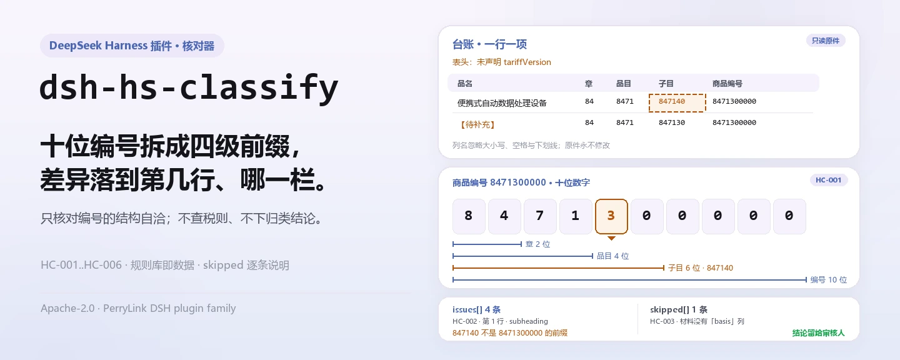
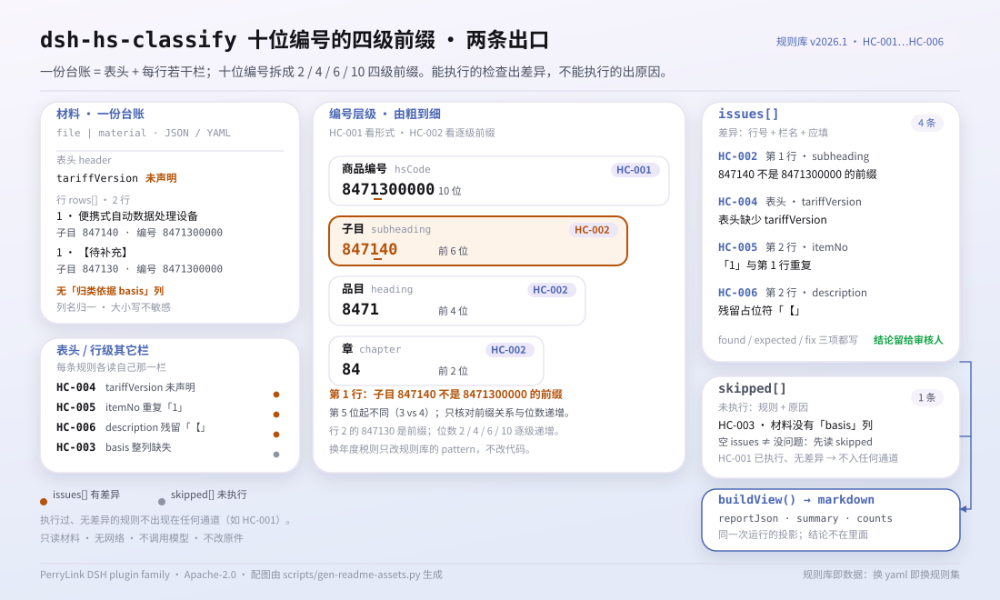

<div align="center">

<picture>
  <source media="(prefers-color-scheme: dark)" srcset="docs/assets/dsh-hs-classify-hero-zh-dark.webp">
  
</picture>

# dsh-hs-classify

**核对整份商品归类台账：哪一行、哪一栏、差什么，逐条列出。**

面向报关员与归类员的 DeepSeek Harness 插件：只核对编号与层级的结构自洽，不改原件、不查税则、不下归类结论。

[安装](#三步上手) · [配置](#配置) · [FAQ](#faq) · [简体中文](README.md) · [English](README.en.md) · [Español](README.es.md) · [Português](README.pt.md) · [हिन्दी](README.hi.md)

[](LICENSE)
[](#兼容性)
[](https://www.npmjs.com/package/dsh-hs-classify)
[](https://github.com/PerryLink/dsh-hs-classify/actions/workflows/ci.yml)
[](#兼容性)

[](https://github.com/PerryLink/dsh-hs-classify/stargazers)
[](https://www.npmjs.com/package/dsh-hs-classify)
[](https://dshfind.com/plugins/PerryLink/dsh-hs-classify?ref=badge)
[](https://securityscorecards.dev/viewer/?uri=github.com/PerryLink/dsh-hs-classify)
[](https://dsh.market/)
[](https://gitee.com/perrylink/dsh-hs-classify)

```sh
dsh plugin --profile <name> add dsh-hs-classify
```

</div>

<sub>社区插件，与 DeepSeek 官方无关。唯一仓库：<https://github.com/PerryLink/dsh-hs-classify>（Gitee 为镜像）。</sub>

## 它是什么

`dsh-hs-classify` 读取一份商品归类台账——表头加每个商品项一行——核对其中编号与层级记录的结构：商品编号是不是十位数字，章、品目、子目是不是该编号的逐级前缀，层级有没有由粗到细，每行有没有填归类依据，表头有没有声明税则版本，项号在台账内是否唯一，品名栏有没有残留模板占位符。它把差异逐条列成「哪一行、哪一栏、差什么」，无法执行的检查放进 `skipped` 并写明原因。它不改原件，不上传材料，不查税则，也不判断商品应当归入哪个编号。

<picture>
  <source media="(prefers-color-scheme: dark)" srcset="docs/assets/dsh-hs-classify-flow-v5-dark.svg">
  
</picture>

## 三步上手

1. **安装**（三选一）：

   ```sh
   # npm 通道（已发布版本）
   dsh plugin --profile web add dsh-hs-classify
   # git 通道（最新 main）
   dsh plugin --profile web add github:PerryLink/dsh-hs-classify
   # tarball 通道：本仓库 pnpm pack 后
   dsh plugin --profile web add ./dsh-hs-classify-<version>.tgz
   ```

   npm 通道与 tarball 通道安装的是构建产物；git 通道会按仓库的 `prepare` 脚本（tsdown）构建 `lib/`。

2. **最小配置**（默认即可用，整行可省略）：

   ```yaml
   - insert:
       - id: dsh-hs-classify
         name: dsh-hs-classify
         config:
           rulesFile: rules/hs-classify.yaml
   ```

   全部可调项见[配置](#配置)；规则库本身是数据文件，替换 `rules/hs-classify.yaml` 即可切换规则集。

3. **验证已生效**：

   ```sh
   dsh --profile web --dump-config | grep 'dsh-hs-classify'
   node samples/quickstart/run.mjs
   ```

   ```text
   hs_classify: 2 issue(s) — error 0, warn 2, info 0
   skipped: 0
   ```

   样例输入在 `samples/quickstart/input/`，期望输出在 `samples/quickstart/expected/result.json`；首次运行截图见 [`docs/assets/quickstart.png`](docs/assets/quickstart.png)。

**卸载**：`dsh plugin --profile web remove dsh-hs-classify`（或从 profile patch 删掉该行）。

## 核心能力

- **六条规则，逐条可指认** —— 每条发现都带 `ruleId`、行号与字段、读到的值、期望关系与核对建议；规则表见下。
- **只报差异，不下结论** —— 不判合规、不认定责任、不替代审核人；渲染层有文字守卫，报告始终带免责声明。
- **空结果不等于没问题** —— 无法执行的检查逐条进 `skipped` 并写明原因：缺列、全列为空、前置条件未满足、规则被停用等。
- **规则库是数据** —— 替换 `rules/hs-classify.yaml` 即可换规则集，无需改 TypeScript；加载期校验字段与严重级上限。
- **本地运行** —— 只读你交给工具的文件或内联材料；无网络请求、无遥测、不调用模型。

| 规则 | 核对什么 | 严重级 | 依据类型 |
|---|---|---|---|
| `HC-001` | 商品编号为十位数字 | warn | principle |
| `HC-002` | 章、品目、子目是商品编号的逐级前缀 | warn | principle |
| `HC-003` | 每行填写归类依据 | warn | direct |
| `HC-004` | 表头声明税则版本 | warn | principle |
| `HC-005` | 项号在台账内唯一 | warn | principle |
| `HC-006` | 品名不含未替换占位符 | warn | principle |

## 它能回答什么

下表是示例集：第一行是详细走查，其余行是简短案例；回答内容来自规则库与已发布的检查行为。

#### 详细输出

**工具** `hs_classify`

**输入**

~~~json
{"rows":[{"品名":"便携式自动数据处理设备","子目":"847140","商品编号":"8471300000"}]}
~~~

**输出**

~~~json
{
  "id": "dsh-hs-classify.HC-002.de09b5a6",
  "ruleId": "HC-002",
  "severity": "warn",
  "locator": {
    "field": "subheading",
    "row": 1
  },
  "found": "第 1 行「subheading」为「847140」，不是「hsCode」（8471300000）的前缀",
  "expected": "「subheading」应与「hsCode」的前几位一致",
  "fix": "核对层级填写；本条只核对前缀关系，不判断归类是否正确"
}
~~~

*Observed from `tests/fixtures/HC-002/HC-002-unsafe.json (cases.json expects HC-002 count 1); run via lib/index.mjs rules/hs-classify.yaml`*

| 你会问 | 它怎么答 |
|---|---|
| 台账里的编号有的是八位，还有一个末位是字母，会被报出吗？ | 会。`HC-001` 把每个已填写的 `hsCode` 与规则库的 `pattern`（`^[0-9]{10}$`）比对，报出该行并附上它读到的值。它只核对位数与字符合法性，绝不判断该商品是否应归入这个编号。编号栏留空的不在本条范围内，所以它报的是形式不对的编号，不是缺填的编号。十位是规则库配置：年度税则改了位数，改 `pattern` 即可，不必改代码。 |
| 某行的章、品目、子目与商品编号对不上，能查出来吗？ | 能。`HC-002` 按由粗到细的顺序读取层级栏——章、品目、子目，规则库自己的示例为 2、4、6 位——报出不是所读 `hsCode` 前缀的那一栏，或不比上一级更细的那一栏。它只核对这一前缀关系与这一顺序：编号是否适用于该商品属海关的归类判断，要查税则与归类决定，本插件不查这些。层级栏留空的不作比较。 |
| 有一行的归类依据是空的。 | `HC-003` 会报出这一行：凡是带这一栏的行，`basis` 都必须填写。它只核对该栏写了没有，不核对所引税则条文、章注、归类决定或预裁定是否存在、是否支持该归类——这些本插件都不查。台账若完全没有 `basis` 栏，`HC-003` 会在 `skipped` 中说明 `材料没有「basis」列，本条不适用`，而不是静默通过。 |
| 表头没有声明这些编号适用哪一版税则。 | `HC-004` 要求表头声明 `tariffVersion`，表头留空即报出该台账。它只核对声明在不在，不判断所写的版本是不是这些编号所属的那一版——本条不读编号，而编码会在各版税则之间拆分与合并。它检查的 `fields` 是规则库配置：表头还记申报人的话，把 `declarant` 加进去即可。 |
| 项号 5 在两行里各出现一次。 | `HC-005` 会把后一行报为与前行重复：`itemNo` 在同一台账内应唯一，比较时忽略空白字符，所以 `5` 与 ` 5 ` 是同一个项号。它只核对唯一性。同一商品分多行申报（例如不同规格）时，每行要用不同的项号。项号全都不重复时，`HC-005` 既不产生条目，也不进入 `skipped`：它确实执行过，只是没有差异；只有整列缺失或全为空、检查无法执行时才会进 `skipped`。 |
| 品名栏还留着模板里的【】或待填。 | `HC-006` 会报出该行以及它匹配到的占位符。规则库查找的是【、】、{{、}}、XXX、xxx、待填、待补充、TBD、todo 与 示例，`terms` 可按本机构模板增减。它只找未替换的占位符：不判断品名对不对，也不要求这一栏必须填写——`description` 单元格留空不会产生差异条目，本规则库中也没有别的规则要求填写品名。 |

## 配置

全部可调参数都在 `src/config.ts` 的 Schemastery schema 中，只改 `cordis.yml` 即可生效，无需改代码；逐条阈值在 `rules/` 下的规则库文件里。

| 键 | 类型 | 默认值 | 说明 |
|---|---|---|---|
| `rulesFile` | string | `rules/hs-classify.yaml` | 规则库文件路径，相对插件包根目录 |
| `disabledRules` | string[] | `[]` | 要停用的规则 id 列表；每条都会出现在 `skipped` 中 |
| `onlyRules` | string[] | `[]` | 只执行这些规则 id；留空表示执行全部规则 |
| `skipNotes` | string | `""` | 附加到每条 `skipped` 说明后的备注 |
| `timeoutMs` | number | `120000` | 工具协作式超时预算（毫秒） |

profile patch 覆盖示例：

```yaml
- insert:
    - id: dsh-hs-classify
      name: dsh-hs-classify
      config:
        onlyRules: [HC-001, HC-002]
        skipNotes: 按本机构实施细则复核
```

## 材料格式

工具接受 JSON 或 YAML，材料可以是文件（`file`）或内联文本（`material`）：

```yaml
declarant: 某某报关行
tariffVersion: 2026 年版税则
rows:
  - { 序号: '1', 品名: 便携式自动数据处理设备, 材质: 塑料外壳、金属结构件、电子元器件,
      功能: 数据处理与显示，重量 1.2 千克, 章: '84', 品目: '8471', 子目: '847130',
      商品编号: '8471300000', 申报日期: 2026-03-10,
      归类依据: 税则第八十四章章注及品目 8471 条文 }
```

列名匹配不区分大小写，并忽略空格、下划线与连字符；台账自己的列名会保留，因此发现里写的就是它读到的那一栏。表头字段与列别名都在 `src/model.ts` 声明一次；材料至少要带 `hsCode` / `description` / `chapter` / `heading` 中的一项。字段在读取层是可选的，由检查引擎校验，因此部分导出的材料会产生「缺项」类差异，而不是让程序崩溃。

## 规则来源

| 文件 | 文号 | 引用它的规则 |
|---|---|---|
| 《中华人民共和国进出口税则》 | 现行版本本次未核实 | HC-001, HC-004, HC-005, HC-006 |
| 《商品名称及编码协调制度》 | 现行版本本次未核实 | HC-002 |
| 《中华人民共和国进出口关税条例》 | 国务院令第392号（2003年11月23日公布；根据2011年1月8日、2013年12月7日、2016年2月6日三次《国务院关于修改（废止）部分行政法规的决定》修订） | HC-003 |

规则数据与代码分离，`plugin`、`version`、`rules`、`disabled` 都在 `rules/hs-classify.yaml` 里。每条规则必须写全 `document` / `number` / `clause` / `excerpt` / `kind` / `source`，加载期强制：`excerpt` 必须是真实引文且不少于八个字符；依据仅为原则性条款（`kind: derived-from-principle`，严重级上限 `warn`）或本机构配置（`kind: institutional-configuration`，上限 `info`）的检查不得标为 `error`。夸大的规则库会在加载期失败，而不会产出一份看起来很有底气的报告。

**规则库参数**（改 `rules/hs-classify.yaml`，不改代码）：

| 规则 | 参数 | 作用 |
|---|---|---|
| `HC-001` | `pattern` | 商品编号的形式，默认 `^[0-9]{10}$`；年度税则改位数时改这里 |
| `HC-002` | `field` / `components` / `digits` | 编号栏、由粗到细的层级栏（默认 `[chapter, heading, subheading]`）与期望总位数 |
| `HC-004` | `fields` | 表头必须声明的字段；默认 `[tariffVersion]`，表头记录申报人就加 `declarant` |
| `HC-006` | `terms` | 要查找的占位符列表，可按本机构模板增减 |

核验中确认的边界与「刻意没有作出的结论」见随包的 `rules/evidence/clause-verification-tariff-regulation.md`。**6 条规则中只有 1 条（`HC-003`）引用到了逐字条文并标 `direct`**；其余 5 条在 `excerpt` 字段本身写明原文本次未取得，并保持在 `warn` 或 `info`。有该注记的规则应当作线索，而不是引证；取得原文后替换 `excerpt` 并把 `kind` 提到 `direct`。十位编码是规则库中的一条 `pattern`，因此年度税则变更需要改规则库，而不是改代码。

## FAQ

<details>
<summary>材料会被上传或保存到别处吗？</summary>

不会。插件是本地核对器：只读取你传给 `hs_classify` 的文件内容或内联文本，不发起网络请求，不附带遥测、分析或后台上报，也不在工具结果与 DSH 宿主自己的会话/日志存储之外写数据。宿主存储的内容与保留期由宿主控制，本包不另存第二份；卸载本包不会删除宿主已有的会话日志或你创建的文件。

</details>

<details>
<summary>报告是空的，是不是说明台账没问题？</summary>

不能这样读。空 `issues` 只说明**已执行的检查**没有发现差异；未执行的检查会逐条列在 `skipped` 里，并写明原因（缺列、全列为空、前置条件未满足、规则被停用等）。先读 `skipped`，再读 `issues`。

</details>

<details>
<summary>会和其他 DSH 插件抢工具名、服务或 slot 吗？</summary>

不会。本插件只注册一个工具 `hs_classify`，不提供 service key，不注册客户端 slot 或 `webServer` 前缀，bundle patch 只 `insert` 自己那一行；逐条论证见「与其他 DSH 插件的互操作性」。

</details>

<details>
<summary>性能开销多大？</summary>

检查在本地做字符串匹配与结构比较：不调用模型、不发网络请求、不做 OCR 或表格识别。工具以 `timeoutMs`（默认 `120000`）声明协作式超时预算，超时由调用方中止。开销随台账行数与规则数线性增长；本仓库没有公开 benchmark，因此不给出具体毫秒数。

</details>

<details>
<summary>规则库没有取得条文原文，还能用吗？</summary>

能用，但要按它的证据状态来读。`excerpt` 明说原文未取得的规则保持 `warn` / `info`，发现里不伪装成引证；它指出的是材料与规则库之间的字面差异，不是法规结论。需要正式引用时，先取得原文、替换 `excerpt` 并把 `kind` 提到 `direct`。

</details>

## 安全边界

- **只核对编号的形态，从不判断归类是否正确。** 归类是海关裁定，取决于商品的材料、功能、加工深度，连同税则的类注、章注与任何归类决定或预裁定；**本插件不查税则、不查归类决定、不查预裁定**。
- **能发现与不能发现。** 它**能**发现「这一行的编号与同一行所写的章、品目、子目不一致」；它**不能**发现「这一行的编号与货物不相符」，因为后者需要税则本身。
- **结构完美的错误编号会通过。** 一份给错误货物配上结构上完美编号的台账会通过本插件；这是已记录的边界，写在规则库库头、`HC-002` 的说明以及随包的 [`TROUBLESHOOTING.md`](TROUBLESHOOTING.md) 中。
- **引文状态逐条如实标注。** 6 条规则中 1 条（`HC-003`）引用逐字条文并标 `direct`；其余 5 条在 `excerpt` 字段里明说原文本次未取得，保持 `warn` / `info`。这类规则应当作线索而不是引证；取得原文后再替换 `excerpt` 并提升 `kind`。
- **空结果不等于没问题。** 未执行的检查逐条进 `skipped` 并写明原因；空 `issues` 只在「已执行的检查」范围内成立。
- **不作出定性结论。** 报告不判合规、不认定责任、不评价归类正确性；文字守卫强制这一点，报告始终带免责声明。
- **本地运行。** 只读你交给工具的文件或内联材料；无网络请求、无遥测、不调用模型；除工具结果与宿主自己的会话/日志存储外不写数据。

## 已知限制

- **范围只有六项结构检查。** 十位编号、层级前缀、归类依据是否填写、税则版本是否声明、项号唯一性、品名占位符；此外的比对（例如商品与编号是否相符）不在本插件内。
- **空值与缺列的处理是明确的。** 编号栏留空不触发 `HC-001`；层级栏留空不参与 `HC-002` 比较；`basis` 栏存在但单元格为空才报 `HC-003`，整列不存在则进 `skipped`；项号全不重复时 `HC-005` 正常通过，且不写入 `skipped`。
- **`HC-002` 只核对前缀关系与位数递增。** 章是前 2 位、品目是前 4 位、子目是前 6 位；编号是否适用于该商品，需要查税则与归类决定，本插件不查。
- **`HC-004` 只核对声明是否存在。** 它不判断所写版本是不是这些编号真正所属的那一版；编码会随年度税则拆分与合并，版本判断需人工核对。
- **五条规则的引文仍是诚实占位。** `HC-001`、`HC-002`、`HC-004`、`HC-005`、`HC-006` 的 `excerpt` 明说税则或协调制度原文本次未取得；它们保持 `warn`，并在报告里如实写明这一缺口。
- **材料必须是 JSON 或 YAML。** Excel、Word、PDF 需先转成结构化文本（对话里也可以代转）；工具不做 OCR，也不解析二进制表格。
- **报告与提示文本当前为中文。** 规则库的 `note`、差异消息与免责声明都是中文；列名沿用你材料里的写法，因此发现里会出现你台账自己的列名。

## 与其他 DSH 插件的互操作性

从代码与 manifest 可核对，本插件不引入工具名、服务键、slot、HTTP 路由与 patch 层冲突：

- **工具面**：只注册一个工具 `hs_classify`，不注册第二个工具或任何 client 面。
- **服务键**：`inject: ['tools']` 只消费 `tools` 服务，不提供任何服务键。
- **slot**：没有 `client/` 目录，不注册客户端 slot key。
- **HTTP 路由**：不注册 `webServer` 前缀，不新增路由。
- **patch 层**：`cordis.patch.yml` 只 `insert` 自己那一行，从不覆写内置行的 `config`。
- **全局与网络**：不改写原型、`process.env` 或全局 fetch；无网络请求、无模型调用。

manifest 的 `capabilities` 只有 `tools:register`；`dsh.demo` 声明 `network: false`、`writes: []`。

## 兼容性

| 项目 | 状态 |
|---|---|
| Harness | 对等版本范围 `>=0.1.2-rc.1 <0.2.0 \|\| >=0.2.0-0 <0.3.0` —— 已实测同时接受 `0.2.0-rc.2` 与 `0.2.1-rc.2`。**已声明 `engines.dsh`**：0.2.1 起由宿主单独裁决，范围为 `>=0.2.1-0 <0.3.0` |
| Node | `^22.19.0 \|\| >=24.0.0` |
| 平台 | 全平台（纯 ESM；无原生代码、无联网、不调用模型） |
| 工具模式 | `native` / `ptc` 均可；批量核对多份材料时用 `ptc`，schema 成本只付一次 |

## 生态与质量

- [Gitee 镜像](https://gitee.com/perrylink/dsh-hs-classify)（同步镜像，以 GitHub 为准）
- [dshfind 插件页](https://dshfind.com/plugins/PerryLink/dsh-hs-classify)（安装量与排名）
- [OpenSSF Scorecard 报告](https://securityscorecards.dev/viewer/?uri=github.com/PerryLink/dsh-hs-classify)（由 [.github/workflows/scorecard.yml](.github/workflows/scorecard.yml) 驱动）
- [DSH Market](https://dsh.market/)（已上架）
- [生态知识库](https://perrylink.github.io/dsh-plugin-guide/)：插件开发指南 · 选型实测数据 · 维护取舍判据

## 开发

```sh
pnpm install
pnpm run typecheck
pnpm test
pnpm run build
pnpm run verify:self-contained
pnpm run check:lockfile
pnpm run check:readmes
pnpm run check:citations
node samples/quickstart/run.mjs
```

`prepublishOnly` 会重跑门禁，因此发布不会带上未构建或漂移的树。目录布局：

| 路径 | 作用 |
|---|---|
| `src/index.ts` | function-plugin 契约：`name` / `inject` / `Config` / `apply`，注册 `hs_classify` 并解析规则库 |
| `src/config.ts` | Schemastery schema；全部可调项都在这里 |
| `src/model.ts` | 表形状与材料契约（列别名、表头别名、必需字段） |
| `src/view.ts` | 面向模型的报告投影；`output.schema` 与它对齐 |
| `src/shared/` | 共享检查引擎、规则库加载器、YAML 子集、报告形状与文字守卫 |
| `rules/hs-classify.yaml` | 规则库，6 条规则 |
| `rules/evidence/` | 每条引用的取证记录 |
| `tests/` | vitest；每条规则都有成对的合规/违规夹具 |
| `samples/quickstart/` | 可复跑的最小样例与期望输出 |
| `scripts/` | 门禁脚本与配图生成脚本 |

README 配图由 [`scripts/gen-readme-assets.py`](scripts/gen-readme-assets.py) 程序化生成（Pillow 画 hero 横幅、手写 SVG 画结构图；命令：`python scripts/gen-readme-assets.py`），产出 `docs/assets/dsh-hs-classify-hero-{zh,en}-{light,dark}.webp` 与 `docs/assets/dsh-hs-classify-flow-v5-{light,dark}.svg`。旧的单版/双版流程图保留在 `docs/assets/` 以防外链失效。仓库内没有 benchmark 数据，因此不出 evidence 图。

Topics：`deepseek-harness`, `dsh`, `dsh-plugin`, `cordis`, `classify`

## 家族与致谢

本项目是 [PerryLink](https://github.com/PerryLink) 维护的 DeepSeek Harness 插件家族成员（全部 Apache-2.0）。如果这个插件帮到了你，**给个 star**——它不解锁任何功能，但会让下一个人更容易找到它。

- [@PerryLink](https://github.com/PerryLink) —— 创建者与维护者：表格 schema、检查引擎、规则库与五语文档。

<details>
<summary>展开全部插件</summary>

| 插件 | 状态 |
|---|---|
| **[dsh-aqua-input-check](https://github.com/PerryLink/dsh-aqua-input-check)** |  |
| **[dsh-archive-check](https://github.com/PerryLink/dsh-archive-check)** |  |
| **[dsh-auto-review](https://github.com/PerryLink/dsh-auto-review)** |  |
| **[dsh-autotier](https://github.com/PerryLink/dsh-autotier)** | 🧊 已冻结 — 见仓库 README |
| **[dsh-bid-ca-precheck](https://github.com/PerryLink/dsh-bid-ca-precheck)** |  |
| **[dsh-bid-qual-check](https://github.com/PerryLink/dsh-bid-qual-check)** |  |
| **[dsh-cert-mcp](https://github.com/PerryLink/dsh-cert-mcp)** | 🧊 已冻结 — 见仓库 README |
| **[dsh-checkpoint-rewind](https://github.com/PerryLink/dsh-checkpoint-rewind)** |  |
| **[dsh-click](https://github.com/PerryLink/dsh-click)** |  |
| **[dsh-composer-history](https://github.com/PerryLink/dsh-composer-history)** |  |
| **[dsh-contract-stance](https://github.com/PerryLink/dsh-contract-stance)** |  |
| **[dsh-customs-doc-check](https://github.com/PerryLink/dsh-customs-doc-check)** |  |
| **[dsh-data-quality](https://github.com/PerryLink/dsh-data-quality)** |  |
| **[dsh-demurrage-ledger](https://github.com/PerryLink/dsh-demurrage-ledger)** |  |
| **[dsh-doublecheck](https://github.com/PerryLink/dsh-doublecheck)** |  |
| **[dsh-drill-script-check](https://github.com/PerryLink/dsh-drill-script-check)** |  |
| **[dsh-eia-guide-check](https://github.com/PerryLink/dsh-eia-guide-check)** |  |
| **[dsh-emergency-plan](https://github.com/PerryLink/dsh-emergency-plan)** |  |
| **[dsh-essay-rubric-check](https://github.com/PerryLink/dsh-essay-rubric-check)** |  |
| **[dsh-evidence-check](https://github.com/PerryLink/dsh-evidence-check)** |  |
| **[dsh-export-ctl-check](https://github.com/PerryLink/dsh-export-ctl-check)** |  |
| **[dsh-fast](https://github.com/PerryLink/dsh-fast)** |  |
| **[dsh-fmea-table-check](https://github.com/PerryLink/dsh-fmea-table-check)** |  |
| **[dsh-forecast-penalty](https://github.com/PerryLink/dsh-forecast-penalty)** |  |
| **[dsh-fund-research](https://github.com/PerryLink/dsh-fund-research)** |  |
| **[dsh-github](https://github.com/PerryLink/dsh-github)** |  |
| **[dsh-gongwen-flow-check](https://github.com/PerryLink/dsh-gongwen-flow-check)** |  |
| **[dsh-gongwen-word-check](https://github.com/PerryLink/dsh-gongwen-word-check)** |  |
| **[dsh-guard-plan-qc](https://github.com/PerryLink/dsh-guard-plan-qc)** |  |
| **[dsh-hazchem-check](https://github.com/PerryLink/dsh-hazchem-check)** |  |
| **[dsh-hazplan-check](https://github.com/PerryLink/dsh-hazplan-check)** |  |
| **[dsh-hidden-risk-map](https://github.com/PerryLink/dsh-hidden-risk-map)** |  |
| **[dsh-hs-classify](https://github.com/PerryLink/dsh-hs-classify)** |  |
| **[dsh-icd-rule-check](https://github.com/PerryLink/dsh-icd-rule-check)** |  |
| **[dsh-industry-research](https://github.com/PerryLink/dsh-industry-research)** |  |
| **[dsh-lawcite-adapter](https://github.com/PerryLink/dsh-lawcite-adapter)** |  |
| **[dsh-laya](https://github.com/PerryLink/dsh-laya)** |  |
| **[dsh-lc-doc-check](https://github.com/PerryLink/dsh-lc-doc-check)** |  |
| **[dsh-learning-gap-check](https://github.com/PerryLink/dsh-learning-gap-check)** |  |
| **[dsh-library](https://github.com/PerryLink/dsh-library)** |  |
| **[dsh-local-ai](https://github.com/PerryLink/dsh-local-ai)** |  |
| **[dsh-lsp-actions](https://github.com/PerryLink/dsh-lsp-actions)** |  |
| **[dsh-mask](https://github.com/PerryLink/dsh-mask)** |  |
| **[dsh-mcp-panel](https://github.com/PerryLink/dsh-mcp-panel)** |  |
| **[dsh-medrec-qc](https://github.com/PerryLink/dsh-medrec-qc)** |  |
| **[dsh-memento](https://github.com/PerryLink/dsh-memento)** |  |
| **[dsh-nsfc-form-check](https://github.com/PerryLink/dsh-nsfc-form-check)** |  |
| **[dsh-nurse-record-check](https://github.com/PerryLink/dsh-nurse-record-check)** |  |
| **[dsh-observe](https://github.com/PerryLink/dsh-observe)** |  |
| **[dsh-origin-rvc-check](https://github.com/PerryLink/dsh-origin-rvc-check)** |  |
| **[dsh-ota-review-check](https://github.com/PerryLink/dsh-ota-review-check)** |  |
| **[dsh-output-styles](https://github.com/PerryLink/dsh-output-styles)** |  |
| **[dsh-paper-doc-adapter](https://github.com/PerryLink/dsh-paper-doc-adapter)** |  |
| **[dsh-permission-rules](https://github.com/PerryLink/dsh-permission-rules)** |  |
| **[dsh-permit-report-check](https://github.com/PerryLink/dsh-permit-report-check)** |  |
| **[dsh-pipeline-check](https://github.com/PerryLink/dsh-pipeline-check)** |  |
| **[dsh-pleading-draft](https://github.com/PerryLink/dsh-pleading-draft)** |  |
| **[dsh-plugin-doctor](https://github.com/PerryLink/dsh-plugin-doctor)** | 🚫 已退役（仓库已归档） |
| **[dsh-plugin-guide](https://github.com/PerryLink/dsh-plugin-guide)** |  |
| **[dsh-plugin-kit](https://github.com/PerryLink/dsh-plugin-kit)** | 🚫 已退役（仓库已归档） |
| **[dsh-plugin-upgrade](https://github.com/PerryLink/dsh-plugin-upgrade)** | 🚫 已退役（仓库已归档） |
| **[dsh-policy-brief-draft](https://github.com/PerryLink/dsh-policy-brief-draft)** |  |
| **[dsh-power-loss-split](https://github.com/PerryLink/dsh-power-loss-split)** |  |
| **[dsh-power-ticket-check](https://github.com/PerryLink/dsh-power-ticket-check)** |  |
| **[dsh-ppap-check](https://github.com/PerryLink/dsh-ppap-check)** |  |
| **[dsh-protest-deadline](https://github.com/PerryLink/dsh-protest-deadline)** |  |
| **[dsh-railway-window](https://github.com/PerryLink/dsh-railway-window)** |  |
| **[dsh-repair-order-qc](https://github.com/PerryLink/dsh-repair-order-qc)** |  |
| **[dsh-research-report](https://github.com/PerryLink/dsh-research-report)** |  |
| **[dsh-review-reply-check](https://github.com/PerryLink/dsh-review-reply-check)** |  |
| **[dsh-rulefile-check](https://github.com/PerryLink/dsh-rulefile-check)** |  |
| **[dsh-safety-brief-check](https://github.com/PerryLink/dsh-safety-brief-check)** |  |
| **[dsh-score](https://github.com/PerryLink/dsh-score)** |  |
| **[dsh-session-sync](https://github.com/PerryLink/dsh-session-sync)** |  |
| **[dsh-site-log-check](https://github.com/PerryLink/dsh-site-log-check)** |  |
| **[dsh-skill-pack-security](https://github.com/PerryLink/dsh-skill-pack-security)** |  |
| **[dsh-soe-decision-check](https://github.com/PerryLink/dsh-soe-decision-check)** |  |
| **[dsh-soilwater-check](https://github.com/PerryLink/dsh-soilwater-check)** |  |
| **[dsh-sop-sync-check](https://github.com/PerryLink/dsh-sop-sync-check)** |  |
| **[dsh-spc-gbt-adapter](https://github.com/PerryLink/dsh-spc-gbt-adapter)** |  |
| **[dsh-talk](https://github.com/PerryLink/dsh-talk)** |  |
| **[dsh-tender-extract](https://github.com/PerryLink/dsh-tender-extract)** |  |
| **[dsh-tender-matrix](https://github.com/PerryLink/dsh-tender-matrix)** |  |
| **[dsh-test-drive](https://github.com/PerryLink/dsh-test-drive)** |  |
| **[dsh-ticktick](https://github.com/PerryLink/dsh-ticktick)** | 🚫 已退役（仓库已归档） |
| **[dsh-translate](https://github.com/PerryLink/dsh-translate)** |  |
| **[dsh-warranty-calc](https://github.com/PerryLink/dsh-warranty-calc)** |  |
| **[dsh-budget](https://github.com/PerryLink/dsh-budget)** | 🧊 已冻结 — 见仓库 README |
| **[dsh-claude-move](https://github.com/PerryLink/dsh-claude-move)** | 🧊 已冻结 — 见仓库 README |
| **[dsh-defend](https://github.com/PerryLink/dsh-defend)** | 🧊 已冻结 — 见仓库 README |
| **[dsh-draw](https://github.com/PerryLink/dsh-draw)** | 🧊 已冻结 — 见仓库 README |
| **[dsh-reach](https://github.com/PerryLink/dsh-reach)** | 🧊 已冻结 — 见仓库 README |
| **[dsh-background-agents](https://github.com/PerryLink/dsh-background-agents)** | 🚫 已退役（仓库已归档） |
| **[dsh-session-pin](https://github.com/PerryLink/dsh-session-pin)** | 🚫 已退役（仓库已归档） |
| **[dsh-team-rooms](https://github.com/PerryLink/dsh-team-rooms)** | 🚫 已退役（仓库已归档） |

</details>

## License

[LICENSE](LICENSE)（Apache License 2.0）© 2026 dsh-hs-classify contributors

<p align="center"><sub>Apache-2.0 · 社区插件，与 DeepSeek 无关。</sub></p>
