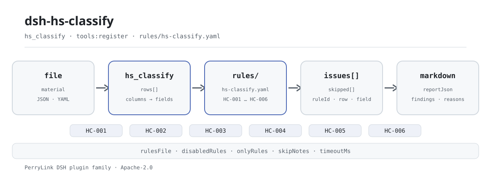

<div align="center">

<picture>
  <source media="(prefers-color-scheme: dark)" srcset="docs/assets/dsh-hs-classify-flow-dark.svg">
  
</picture>

# dsh-hs-classify

**Verifique um registo completo de classificação de mercadorias: que linha, que coluna e o que difere, uma a uma.**

Um verificador de DeepSeek Harness para declarantes e classificadores aduaneiros: verifica apenas a coerência estrutural dos códigos e dos níveis — não altera o original, não consulta a pauta e não emite um parecer de classificação.

[Instalar](#instalação-em-três-passos) · [Configuração](#configuração) · [FAQ](#faq) · [简体中文](README.md) · [English](README.en.md) · [Español](README.es.md) · [Português](README.pt.md) · [हिन्दी](README.hi.md)

[](LICENSE)
[](#compatibilidade)
[](https://www.npmjs.com/package/dsh-hs-classify)
[](https://github.com/PerryLink/dsh-hs-classify/actions/workflows/ci.yml)
[](#compatibilidade)

[](https://github.com/PerryLink/dsh-hs-classify/stargazers)
[](https://www.npmjs.com/package/dsh-hs-classify)
[](https://dshfind.com/plugins/PerryLink/dsh-hs-classify?ref=badge)
[](https://securityscorecards.dev/viewer/?uri=github.com/PerryLink/dsh-hs-classify)
[](https://dsh.market/)
[](https://gitee.com/perrylink/dsh-hs-classify)

```sh
dsh plugin --profile <name> add dsh-hs-classify
```

</div>

<sub>Plugin da comunidade, sem afiliação com a DeepSeek. Repositório canônico: <https://github.com/PerryLink/dsh-hs-classify> (o Gitee é um espelho).</sub>

## O que é

`dsh-hs-classify` lê um registo de classificação de mercadorias — o cabeçalho do declarante mais uma linha por item — e verifica a estrutura dos números que regista: se o código de mercadoria tem dez dígitos, se o capítulo, a posição e a subposição são prefixos sucessivos desse código, se os níveis vão do mais geral para o mais específico, se cada linha regista um fundamento de classificação, se o cabeçalho declara a versão da pauta a que os códigos pertencem, se os números de item são únicos no registo e se não resta nenhum marcador de modelo por substituir na designação. Devolve as diferenças como «que linha, que coluna, o que difere», e cada verificação que não pôde correr aparece em `skipped` com o motivo. Não altera o original, não envia o material, não consulta a pauta e não decide em que código as mercadorias devem ser classificadas.

## Instalação em três passos

1. **Instale** (escolha um canal):

   ```sh
   # canal npm (versões publicadas)
   dsh plugin --profile web add dsh-hs-classify
   # canal git (último main)
   dsh plugin --profile web add github:PerryLink/dsh-hs-classify
   # canal tarball: pnpm pack neste repositório e depois
   dsh plugin --profile web add ./dsh-hs-classify-<version>.tgz
   ```

   Os canais npm e tarball instalam artefactos já compilados; o canal git executa o script `prepare` do repositório (tsdown) para gerar `lib/`.

2. **Configuração mínima** (os valores por defeito já funcionam; a linha inteira pode ser omitida):

   ```yaml
   - insert:
       - id: dsh-hs-classify
         name: dsh-hs-classify
         config:
           rulesFile: rules/hs-classify.yaml
   ```

   Todos os ajustes estão em [Configuração](#configuração); o pacote de regras é um arquivo de dados, pelo que substituir `rules/hs-classify.yaml` troca o conjunto de regras.

3. **Confirme que monta**:

   ```sh
   dsh --profile web --dump-config | grep 'dsh-hs-classify'
   node samples/quickstart/run.mjs
   ```

   ```text
   hs_classify: 2 issue(s) — error 0, warn 2, info 0
   skipped: 0
   ```

   A entrada de exemplo está em `samples/quickstart/input/`, o resultado esperado em `samples/quickstart/expected/result.json` e a captura da primeira execução em [`docs/assets/quickstart.png`](docs/assets/quickstart.png).

**Desinstalar**: `dsh plugin --profile web remove dsh-hs-classify` (ou remova a linha do patch do perfil).

## Capacidades principais

- **Seis regras, cada achado rastreável** — todo achado traz `ruleId`, linha e campo, o valor lido, a relação esperada e uma sugestão de revisão; a tabela de regras vem a seguir.
- **Diferenças, nunca pareceres** — não declara conformidade nem responsabilidade, não substitui o revisor; um guardião de redação impõe isso e todo relatório traz o aviso.
- **Um resultado vazio não é um certificado de limpeza** — cada verificação que não pôde correr aparece em `skipped` com o motivo: coluna ausente, coluna inteira vazia, pré-condição não cumprida, regra desativada.
- **O pacote de regras é dados** — substituir `rules/hs-classify.yaml` troca o conjunto de regras sem tocar em TypeScript; o carregador valida os campos e os limites de severidade.
- **Apenas local** — lê o arquivo ou o material em linha que lhe passa; sem pedidos de rede, sem telemetria, sem chamadas ao modelo.

| Regra | Verifica | Severidade | Tipo de base |
|---|---|---|---|
| `HC-001` | o código de mercadoria tem dez dígitos | warn | principle |
| `HC-002` | capítulo, posição e subposição são prefixos sucessivos do código | warn | principle |
| `HC-003` | cada linha regista um fundamento de classificação | warn | direct |
| `HC-004` | o cabeçalho declara a versão da pauta | warn | principle |
| `HC-005` | os números de item são únicos no registo | warn | principle |
| `HC-006` | a designação não conserva marcadores por substituir | warn | principle |

## O que ele responde

A tabela seguinte é o conjunto de exemplos: a primeira linha é o caso detalhado e as demais são casos curtos; as respostas vêm do pacote de regras e do comportamento publicado.

#### Saída detalhada

**Ferramenta** `hs_classify`

**Entrada**

~~~json
{"rows":[{"品名":"便携式自动数据处理设备","子目":"847140","商品编号":"8471300000"}]}
~~~

**Saída**

~~~json
{
  "id": "dsh-hs-classify.HC-002.de09b5a6",
  "ruleId": "HC-002",
  "severity": "warn",
  "locator": {
    "field": "subheading",
    "row": 1
  },
  "found": "第 1 行「subheading」为「847140」，不是「hsCode」（8471300000）的前缀",
  "expected": "「subheading」应与「hsCode」的前几位一致",
  "fix": "核对层级填写；本条只核对前缀关系，不判断归类是否正确"
}
~~~

*Observed from `tests/fixtures/HC-002/HC-002-unsafe.json (cases.json expects HC-002 count 1); run via lib/index.mjs rules/hs-classify.yaml`*

| Você pergunta | O que ele responde |
|---|---|
| Alguns códigos do registo têm oito dígitos e um termina numa letra. Isso é reportado? | Sim. `HC-001` compara cada `hsCode` preenchido com o `pattern` do pacote de regras, `^[0-9]{10}$`, e reporta a linha com o valor que leu. Verifica apenas o número de dígitos e os caracteres, nunca se a mercadoria pertence a esse código. Uma célula de código em branco é ignorada: o que ele reporta é um código com a forma errada, não um código em falta. Os dez dígitos são uma definição do pacote de regras: quando a pauta anual mudar o comprimento, edita-se o `pattern`, não o código. |
| O 章, o 品目 e o 子目 de uma linha não concordam com o seu 商品编号. Isso é detetado? | Sim. `HC-002` lê as colunas de nível do mais geral para o mais específico — 章, 品目 e 子目, dois, quatro e seis dígitos no exemplo do próprio pacote de regras — e assinala o nível que não é prefixo do `hsCode` lido, ou que não é mais fino do que o nível anterior. Verifica apenas essa relação de prefixo e essa ordem: se o código corresponde à mercadoria é uma determinação aduaneira que exige a pauta e as decisões de classificação, que este plugin não consulta. Uma célula de nível em branco não é comparada. |
| Uma linha deixa a 归类依据 vazia. | `HC-003` reporta essa linha: `basis` tem de estar preenchido em todas as linhas que trazem a coluna. Verifica que algo esteja escrito, não que a disposição pautal, a nota de capítulo, a decisão de classificação ou a informação pautal vinculativa citadas existam ou sustentem a classificação — este plugin não consulta nada disso. Se o registo não tiver coluna `basis`, `HC-003` aparece em `skipped` a indicar que o material não tem essa coluna, em vez de passar em silêncio. |
| O cabeçalho não diz a que versão da pauta pertencem os códigos. | `HC-004` exige que o cabeçalho declare `tariffVersion` e reporta o registo quando o deixa vazio. Verifica que a declaração exista, não que a edição indicada seja a destes códigos: a regra não lê os códigos, e os códigos são divididos e fundidos entre edições. A sua lista `fields` é uma definição do pacote de regras: acrescente `declarant` se o seu cabeçalho o registar. |
| O 项号 5 aparece em duas linhas. | `HC-005` reporta a linha posterior como duplicada da anterior, porque `itemNo` tem de ser único dentro do mesmo registo; a comparação ignora espaços, por isso `5` e ` 5 ` são o mesmo número de item. Verifica apenas a unicidade. Uma mercadoria declarada em várias linhas, por especificações diferentes, precisa de um número de item diferente em cada uma. Mesmo sem números repetidos, `HC-005` não produz achados nem aparece em `skipped`: a verificação correu e não encontrou diferenças; só uma coluna ausente ou totalmente vazia a faz saltar. |
| A coluna 品名 ainda tem marcadores do modelo. | `HC-006` reporta a linha e o marcador que encontrou. O pacote de regras procura 【, 】, {{, }}, XXX, xxx, 待填, 待补充, TBD, todo e 示例, e `terms` pode ser ajustado ao seu próprio modelo. Procura apenas marcadores não substituídos: não julga se o nome está correto e também não exige que a coluna esteja preenchida — uma célula `description` vazia não lhe produz qualquer achado, e nenhuma outra regra deste pacote a exige. |

## Configuração

Todos os parâmetros ajustáveis são campos Schemastery em `src/config.ts`, portanto mudam pelo `cordis.yml` sem editar código; os limites por regra ficam no pacote de regras sob `rules/`.

| Chave | Tipo | Padrão | Descrição |
|---|---|---|---|
| `rulesFile` | string | `rules/hs-classify.yaml` | Caminho do pacote de regras, relativo à raiz do pacote |
| `disabledRules` | string[] | `[]` | Ids de regras a desativar; cada uma aparece em `skipped` |
| `onlyRules` | string[] | `[]` | Executar apenas estas regras; vazio executa todas |
| `skipNotes` | string | `""` | Nota acrescentada a cada motivo de `skipped` |
| `timeoutMs` | number | `120000` | Orçamento de tempo limite cooperativo da ferramenta, em milissegundos |

Exemplo de substituição no patch do perfil:

```yaml
- insert:
    - id: dsh-hs-classify
      name: dsh-hs-classify
      config:
        onlyRules: [HC-001, HC-002]
        skipNotes: revisto com as nossas regras internas
```

## Formato do material

A ferramenta aceita JSON ou YAML, como arquivo (`file`) ou texto em linha (`material`):

```yaml
declarant: 某某报关行
tariffVersion: 2026 年版税则
rows:
  - { 序号: '1', 品名: 便携式自动数据处理设备, 材质: 塑料外壳、金属结构件、电子元器件,
      功能: 数据处理与显示，重量 1.2 千克, 章: '84', 品目: '8471', 子目: '847130',
      商品编号: '8471300000', 申报日期: 2026-03-10,
      归类依据: 税则第八十四章章注及品目 8471 条文 }
```

Os nomes de coluna são comparados sem distinguir maiúsculas e ignorando espaços, sublinhados e hífenes; os nomes próprios do registo são mantidos, por isso um achado nomeia a coluna que leu. Os campos de cabeçalho e os aliases de coluna são declarados uma única vez em `src/model.ts`; o material deve trazer pelo menos um de `hsCode` / `description` / `chapter` / `heading`. Os campos são opcionais na camada de leitura e validados pelo motor, pelo que uma exportação parcial produz achados de «campo ausente» em vez de falhar.

## Origem das regras

| Documento | Número | Regras que o citam |
|---|---|---|
| 《中华人民共和国进出口税则》 | versão em vigor não verificada nesta passagem | HC-001, HC-004, HC-005, HC-006 |
| 《商品名称及编码协调制度》 | versão em vigor não verificada nesta passagem | HC-002 |
| 《中华人民共和国进出口关税条例》 | Decreto do Conselho de Estado n.º 392 (promulgado em 23-11-2003; revisto em 08-01-2011, 07-12-2013 e 06-02-2016) | HC-003 |

Os dados das regras estão separados do código: `plugin`, `version`, `rules` e `disabled` vivem em `rules/hs-classify.yaml`. Cada regra deve trazer `document` / `number` / `clause` / `excerpt` / `kind` / `source`, e o carregador impõe que um `excerpt` seja uma citação real de pelo menos oito caracteres, e que uma verificação baseada apenas num princípio (`kind: derived-from-principle`, teto `warn`) ou numa configuração institucional (`kind: institutional-configuration`, teto `info`) nunca seja declarada `error`. Um pacote que exagera a sua base falha ao carregar em vez de produzir um relatório com tom de autoridade.

**Parâmetros do pacote de regras** (editam-se em `rules/hs-classify.yaml`, não no código):

| Regra | Parâmetro | Efeito |
|---|---|---|
| `HC-001` | `pattern` | a forma do código, `^[0-9]{10}$` por padrão; mude-o se a pauta anual alterar o comprimento |
| `HC-002` | `field` / `components` / `digits` | a coluna do código, as colunas de nível do mais geral para o mais específico (`[chapter, heading, subheading]`) e o comprimento total esperado |
| `HC-004` | `fields` | campos de cabeçalho obrigatórios; `[tariffVersion]` por padrão, acrescente `declarant` se o seu cabeçalho o registar |
| `HC-006` | `terms` | a lista de marcadores a procurar |

Os limites verificados e as conclusões deliberadamente **não** afirmadas estão em `rules/evidence/clause-verification-tariff-regulation.md`. **Apenas 1 das 6 regras (`HC-003`) cita texto literal e está marcada `direct`**; as outras 5 dizem no próprio campo `excerpt` que o texto não foi obtido e ficam em `warn` ou `info`. Onde uma regra conserve essa nota, trate-a como pista e não como citação; quando tiver o texto, substitua o `excerpt` e suba `kind` para `direct`. A suposição de dez dígitos é um `pattern` do pacote de regras, pelo que uma mudança anual da pauta exige editar o pacote, não o código.

## FAQ

<details>
<summary>O material é enviado ou guardado noutro sítio?</summary>

Não. É um verificador local: lê apenas o conteúdo do arquivo ou o texto em linha que passa ao `hs_classify`, não faz pedidos de rede, não inclui telemetria, analítica nem relatórios em segundo plano, e não escreve dados fora do resultado da ferramenta e do armazenamento de sessão/registos do próprio host DSH. O host controla esse armazenamento e a sua retenção; este pacote não acrescenta uma segunda cópia. Desinstalar o pacote não apaga os registos de sessão do host nem os documentos que já criou.

</details>

<details>
<summary>O relatório está vazio — significa que o registo está bem?</summary>

Não. Uma lista `issues` vazia significa que **as verificações que correram** não encontraram diferenças. Toda a verificação que não correu aparece em `skipped` com o motivo (coluna ausente, coluna inteira vazia, pré-condição não cumprida, regra desativada). Leia `skipped` antes de `issues`.

</details>

<details>
<summary>Concorre com outros plugins DSH por nomes de ferramenta, serviços ou slots?</summary>

Não. Regista uma única ferramenta, `hs_classify`, não fornece qualquer chave de serviço, não regista slots de cliente nem prefixo `webServer`, e o patch do bundle apenas `insert`a a sua própria linha; o argumento ponto por ponto está em «Interoperabilidade com outros plugins DSH».

</details>

<details>
<summary>Qual é a sobrecarga de desempenho?</summary>

As verificações são comparação local de cadeias e estrutura: sem chamadas ao modelo, sem pedidos de rede, sem OCR nem reconhecimento de tabelas. A ferramenta declara um orçamento cooperativo `timeoutMs` (por padrão `120000`) que quem chama pode abortar. O custo cresce com o número de linhas e de regras; este repositório não publica benchmark, pelo que não se afirma qualquer valor em milissegundos.

</details>

<details>
<summary>O pacote de regras não obteve o texto das cláusulas — continua utilizável?</summary>

Sim, mas leia-o pelo seu estado de evidência. Uma regra cujo `excerpt` diz que o texto não foi obtido fica em `warn` / `info`, e o achado nunca se apresenta como citação; aponta uma diferença literal entre o material e o pacote, não uma conclusão jurídica. Para citar formalmente, obtenha primeiro o texto, substitua o `excerpt` e suba `kind` para `direct`.

</details>

## Limites de segurança

- **Verifica a forma de um código, nunca se o código está certo.** A classificação é uma determinação aduaneira que depende do material, da função e do grau de elaboração da mercadoria, em conjunto com as notas de secção e de capítulo da pauta e qualquer decisão de classificação ou informação pautal vinculativa. **Este plugin não consulta a pauta, não consulta decisões de classificação e não consulta pareceres.**
- **O que pode e não pode encontrar.** **Pode** encontrar «o código desta linha não concorda com o capítulo, a posição e a subposição que a mesma linha declara»; **não pode** encontrar «o código desta linha não corresponde à mercadoria», porque isso exige a própria pauta.
- **Um código estruturalmente perfeito para a mercadoria errada passa.** Um registo com um código estruturalmente perfeito para a mercadoria errada passa este plugin; é o limite documentado, declarado no cabeçalho do pacote, na nota de `HC-002` e no [`TROUBLESHOOTING.md`](TROUBLESHOOTING.md) incluído.
- **O estado das citações é declarado regra por regra.** 1 das 6 regras (`HC-003`) cita texto literal e está marcada `direct`; as outras 5 dizem no próprio campo `excerpt` que o texto não foi obtido e ficam em `warn` / `info`. Trate essas regras como pistas, não como citações; obtenha o texto e depois substitua o `excerpt` e suba `kind`.
- **Um resultado vazio não é um certificado de limpeza.** Toda a verificação que não pôde correr aparece em `skipped` com o motivo; uma lista `issues` vazia cobre apenas as verificações executadas.
- **Sem linguagem que emita pareceres.** O relatório não se pronuncia sobre conformidade, responsabilidade ou correção da classificação; um guardião de redação impõe isso e todo o relatório traz o aviso.
- **Apenas local.** Lê apenas o arquivo ou o material em linha que passa à ferramenta; sem pedidos de rede, sem telemetria, sem chamadas ao modelo; não escreve nada fora do resultado da ferramenta e do armazenamento de sessão/registos do host.

## Limitações conhecidas

- **O âmbito são exatamente seis verificações estruturais.** Código de dez dígitos, prefixos de nível, fundamento registado, versão da pauta declarada, unicidade dos números de item e marcadores na designação; qualquer outra comparação (por exemplo, se a mercadoria se enquadra num código) fica fora deste plugin.
- **Células vazias e colunas ausentes são tratadas de forma explícita.** Uma célula de código vazia não aciona `HC-001`; uma célula de nível vazia não é comparada em `HC-002`; `HC-003` dispara quando a coluna `basis` existe mas uma célula está vazia, e lista-se em `skipped` quando toda a coluna falta; se todos os números de item forem distintos, `HC-005` passa sem entrada em `skipped`.
- **`HC-002` verifica apenas a relação de prefixo e o aumento de comprimento.** O capítulo são os 2 primeiros dígitos, a posição os 4 primeiros, a subposição os 6 primeiros; se o código corresponde à mercadoria exige a pauta e as decisões de classificação, que este plugin não consulta.
- **`HC-004` verifica apenas se a declaração existe.** Não julga se a edição indicada é a destes códigos; os códigos são divididos e fundidos entre edições anuais, pelo que esse juízo exige uma pessoa.
- **Cinco regras continuam a levar marcadores de citação honestos.** `HC-001`, `HC-002`, `HC-004`, `HC-005` e `HC-006` dizem em `excerpt` que o texto da pauta ou do sistema harmonizado não foi obtido; ficam em `warn` e o relatório declara essa lacuna.
- **O material tem de ser JSON ou YAML.** Ficheiros Excel, Word e PDF têm de ser convertidos primeiro em texto estruturado (pode ser feito no chat); a ferramenta não faz OCR nem analisa tabelas binárias.
- **O texto do relatório e das indicações está atualmente em chinês.** O `note` do pacote, as mensagens de diferença e o aviso estão em chinês; os nomes de coluna seguem o seu próprio material, pelo que os achados levam os nomes de coluna do seu registo.

## Interoperabilidade com outros plugins DSH

Pelo código e pelo manifesto, este plugin não introduz colisões de nome de ferramenta, chave de serviço, slot, rota HTTP ou camada de patch:

- **Superfície de ferramentas**: regista uma única ferramenta, `hs_classify`, e nenhuma segunda ferramenta ou face de cliente.
- **Chave de serviço**: `inject: ['tools']` consome apenas o serviço `tools` e não fornece qualquer chave de serviço.
- **Slots**: não existe diretório `client/` nem se regista qualquer chave de slot de cliente.
- **Rotas HTTP**: nenhum prefixo `webServer` e nenhuma rota nova.
- **Camada de patch**: `cordis.patch.yml` apenas `insert`a a sua própria linha e nunca sobrepõe o `config` de uma linha integrada.
- **Globais e rede**: não faz patch de protótipos, não reescreve `process.env` nem substitui o fetch global; sem pedidos de rede, sem chamadas ao modelo.

As `capabilities` do manifesto são apenas `tools:register`; `dsh.demo` declara `network: false` e `writes: []`.

## Compatibilidade

| Superfície | Estado |
|---|---|
| Harness | Faixa de peers `>=0.1.2-rc.1 <0.2.0 \|\| >=0.2.0-0 <0.3.0` — verificada para aceitar tanto `0.2.0-rc.2` quanto `0.2.1-rc.2`. **`engines.dsh` é declarado como `>=0.2.1-0 <0.3.0`** e o host o aplica desde 0.2.1 |
| Node | `^22.19.0 \|\| >=24.0.0` |
| Plataformas | Todas (ESM puro; sem código nativo, sem rede, sem chamada ao modelo) |
| Modo de ferramenta | Funciona em `native` e `ptc`; para verificar vários materiais em lote use `ptc`, que paga o custo do schema uma só vez |

## Ecossistema e qualidade

- [Espelho no Gitee](https://gitee.com/perrylink/dsh-hs-classify) (espelho sincronizado; o GitHub é o canônico)
- [Página no dshfind](https://dshfind.com/plugins/PerryLink/dsh-hs-classify) (instalações e ranking)
- [Relatório OpenSSF Scorecard](https://securityscorecards.dev/viewer/?uri=github.com/PerryLink/dsh-hs-classify) (impulsionado por [.github/workflows/scorecard.yml](.github/workflows/scorecard.yml))
- [DSH Market](https://dsh.market/) (publicado)
- [Base de conhecimento do ecossistema](https://perrylink.github.io/dsh-plugin-guide/): guia de desenvolvimento de plugins · dados de seleção · critérios de manutenção

## Desenvolvimento

```sh
pnpm install
pnpm run typecheck
pnpm test
pnpm run build
pnpm run verify:self-contained
pnpm run check:lockfile
pnpm run check:readmes
pnpm run check:citations
node samples/quickstart/run.mjs
```

O `prepublishOnly` volta a correr a porta, pelo que uma release não pode publicar uma árvore por compilar ou desviada. Estrutura:

| Caminho | Função |
|---|---|
| `src/index.ts` | contrato function-plugin: `name` / `inject` / `Config` / `apply`, regista `hs_classify` e resolve o pacote de regras |
| `src/config.ts` | esquema Schemastery; todos os ajustes vivem aqui |
| `src/model.ts` | forma da tabela e contrato do material (aliases de coluna, aliases de cabeçalho, campos obrigatórios) |
| `src/view.ts` | projeção do relatório para o modelo; `output.schema` reflete-a |
| `src/shared/` | motor de verificação partilhado, carregador do pacote de regras, subconjunto YAML, forma do relatório e guardião de redação |
| `rules/hs-classify.yaml` | o pacote de regras, 6 regras |
| `rules/evidence/` | o registo de verificação de cada citação |
| `tests/` | vitest; cada regra tem um fixture conforme e outro infrator |
| `samples/quickstart/` | a amostra mínima reexecutável e o resultado esperado |
| `scripts/` | scripts de porta e o gerador de imagens |

As imagens do README são geradas programaticamente por [`scripts/gen-readme-assets.py`](scripts/gen-readme-assets.py) (Python + Pillow; execute `python scripts/gen-readme-assets.py`), produzindo `docs/assets/dsh-hs-classify-flow-{light,dark}.svg`. O antigo `docs/assets/dsh-hs-classify-flow.svg` de tema único é conservado para que os links externos continuem a resolver. Este repositório não tem dados de benchmark, pelo que não é desenhado gráfico de evidência.

Topics: `deepseek-harness`, `dsh`, `dsh-plugin`, `cordis`, `classify`

## Família e agradecimentos

Este projeto faz parte da família de plugins de DeepSeek Harness da [PerryLink](https://github.com/PerryLink) (todos Apache-2.0). Se lhe for útil, **uma estrela ajuda a próxima pessoa a encontrá-lo** — não desbloqueia nenhuma funcionalidade.

- [@PerryLink](https://github.com/PerryLink) — criador e mantenedor: o esquema de tabela, o motor de verificação, o pacote de regras e a documentação em cinco idiomas.

<details>
<summary>Expandir todos os plugins</summary>

| Plugin | Status |
|---|---|
| **[dsh-aqua-input-check](https://github.com/PerryLink/dsh-aqua-input-check)** |  |
| **[dsh-archive-check](https://github.com/PerryLink/dsh-archive-check)** |  |
| **[dsh-auto-review](https://github.com/PerryLink/dsh-auto-review)** |  |
| **[dsh-autotier](https://github.com/PerryLink/dsh-autotier)** | 🧊 CONGELADO — ver o README do repo |
| **[dsh-bid-ca-precheck](https://github.com/PerryLink/dsh-bid-ca-precheck)** |  |
| **[dsh-bid-qual-check](https://github.com/PerryLink/dsh-bid-qual-check)** |  |
| **[dsh-cert-mcp](https://github.com/PerryLink/dsh-cert-mcp)** | 🧊 CONGELADO — ver o README do repo |
| **[dsh-checkpoint-rewind](https://github.com/PerryLink/dsh-checkpoint-rewind)** |  |
| **[dsh-click](https://github.com/PerryLink/dsh-click)** |  |
| **[dsh-composer-history](https://github.com/PerryLink/dsh-composer-history)** |  |
| **[dsh-contract-stance](https://github.com/PerryLink/dsh-contract-stance)** |  |
| **[dsh-customs-doc-check](https://github.com/PerryLink/dsh-customs-doc-check)** |  |
| **[dsh-data-quality](https://github.com/PerryLink/dsh-data-quality)** |  |
| **[dsh-demurrage-ledger](https://github.com/PerryLink/dsh-demurrage-ledger)** |  |
| **[dsh-doublecheck](https://github.com/PerryLink/dsh-doublecheck)** |  |
| **[dsh-drill-script-check](https://github.com/PerryLink/dsh-drill-script-check)** |  |
| **[dsh-eia-guide-check](https://github.com/PerryLink/dsh-eia-guide-check)** |  |
| **[dsh-emergency-plan](https://github.com/PerryLink/dsh-emergency-plan)** |  |
| **[dsh-essay-rubric-check](https://github.com/PerryLink/dsh-essay-rubric-check)** |  |
| **[dsh-evidence-check](https://github.com/PerryLink/dsh-evidence-check)** |  |
| **[dsh-export-ctl-check](https://github.com/PerryLink/dsh-export-ctl-check)** |  |
| **[dsh-fast](https://github.com/PerryLink/dsh-fast)** |  |
| **[dsh-fmea-table-check](https://github.com/PerryLink/dsh-fmea-table-check)** |  |
| **[dsh-forecast-penalty](https://github.com/PerryLink/dsh-forecast-penalty)** |  |
| **[dsh-fund-research](https://github.com/PerryLink/dsh-fund-research)** |  |
| **[dsh-github](https://github.com/PerryLink/dsh-github)** |  |
| **[dsh-gongwen-flow-check](https://github.com/PerryLink/dsh-gongwen-flow-check)** |  |
| **[dsh-gongwen-word-check](https://github.com/PerryLink/dsh-gongwen-word-check)** |  |
| **[dsh-guard-plan-qc](https://github.com/PerryLink/dsh-guard-plan-qc)** |  |
| **[dsh-hazchem-check](https://github.com/PerryLink/dsh-hazchem-check)** |  |
| **[dsh-hazplan-check](https://github.com/PerryLink/dsh-hazplan-check)** |  |
| **[dsh-hidden-risk-map](https://github.com/PerryLink/dsh-hidden-risk-map)** |  |
| **[dsh-hs-classify](https://github.com/PerryLink/dsh-hs-classify)** |  |
| **[dsh-icd-rule-check](https://github.com/PerryLink/dsh-icd-rule-check)** |  |
| **[dsh-industry-research](https://github.com/PerryLink/dsh-industry-research)** |  |
| **[dsh-lawcite-adapter](https://github.com/PerryLink/dsh-lawcite-adapter)** |  |
| **[dsh-laya](https://github.com/PerryLink/dsh-laya)** |  |
| **[dsh-lc-doc-check](https://github.com/PerryLink/dsh-lc-doc-check)** |  |
| **[dsh-learning-gap-check](https://github.com/PerryLink/dsh-learning-gap-check)** |  |
| **[dsh-library](https://github.com/PerryLink/dsh-library)** |  |
| **[dsh-local-ai](https://github.com/PerryLink/dsh-local-ai)** |  |
| **[dsh-lsp-actions](https://github.com/PerryLink/dsh-lsp-actions)** |  |
| **[dsh-mask](https://github.com/PerryLink/dsh-mask)** |  |
| **[dsh-mcp-panel](https://github.com/PerryLink/dsh-mcp-panel)** |  |
| **[dsh-medrec-qc](https://github.com/PerryLink/dsh-medrec-qc)** |  |
| **[dsh-memento](https://github.com/PerryLink/dsh-memento)** |  |
| **[dsh-nsfc-form-check](https://github.com/PerryLink/dsh-nsfc-form-check)** |  |
| **[dsh-nurse-record-check](https://github.com/PerryLink/dsh-nurse-record-check)** |  |
| **[dsh-observe](https://github.com/PerryLink/dsh-observe)** |  |
| **[dsh-origin-rvc-check](https://github.com/PerryLink/dsh-origin-rvc-check)** |  |
| **[dsh-ota-review-check](https://github.com/PerryLink/dsh-ota-review-check)** |  |
| **[dsh-output-styles](https://github.com/PerryLink/dsh-output-styles)** |  |
| **[dsh-paper-doc-adapter](https://github.com/PerryLink/dsh-paper-doc-adapter)** |  |
| **[dsh-permission-rules](https://github.com/PerryLink/dsh-permission-rules)** |  |
| **[dsh-permit-report-check](https://github.com/PerryLink/dsh-permit-report-check)** |  |
| **[dsh-pipeline-check](https://github.com/PerryLink/dsh-pipeline-check)** |  |
| **[dsh-pleading-draft](https://github.com/PerryLink/dsh-pleading-draft)** |  |
| **[dsh-plugin-doctor](https://github.com/PerryLink/dsh-plugin-doctor)** | 🚫 APOSENTADO (repo arquivado) |
| **[dsh-plugin-guide](https://github.com/PerryLink/dsh-plugin-guide)** |  |
| **[dsh-plugin-kit](https://github.com/PerryLink/dsh-plugin-kit)** | 🚫 APOSENTADO (repo arquivado) |
| **[dsh-plugin-upgrade](https://github.com/PerryLink/dsh-plugin-upgrade)** | 🚫 APOSENTADO (repo arquivado) |
| **[dsh-policy-brief-draft](https://github.com/PerryLink/dsh-policy-brief-draft)** |  |
| **[dsh-power-loss-split](https://github.com/PerryLink/dsh-power-loss-split)** |  |
| **[dsh-power-ticket-check](https://github.com/PerryLink/dsh-power-ticket-check)** |  |
| **[dsh-ppap-check](https://github.com/PerryLink/dsh-ppap-check)** |  |
| **[dsh-protest-deadline](https://github.com/PerryLink/dsh-protest-deadline)** |  |
| **[dsh-railway-window](https://github.com/PerryLink/dsh-railway-window)** |  |
| **[dsh-repair-order-qc](https://github.com/PerryLink/dsh-repair-order-qc)** |  |
| **[dsh-research-report](https://github.com/PerryLink/dsh-research-report)** |  |
| **[dsh-review-reply-check](https://github.com/PerryLink/dsh-review-reply-check)** |  |
| **[dsh-rulefile-check](https://github.com/PerryLink/dsh-rulefile-check)** |  |
| **[dsh-safety-brief-check](https://github.com/PerryLink/dsh-safety-brief-check)** |  |
| **[dsh-score](https://github.com/PerryLink/dsh-score)** |  |
| **[dsh-session-sync](https://github.com/PerryLink/dsh-session-sync)** |  |
| **[dsh-site-log-check](https://github.com/PerryLink/dsh-site-log-check)** |  |
| **[dsh-skill-pack-security](https://github.com/PerryLink/dsh-skill-pack-security)** |  |
| **[dsh-soe-decision-check](https://github.com/PerryLink/dsh-soe-decision-check)** |  |
| **[dsh-soilwater-check](https://github.com/PerryLink/dsh-soilwater-check)** |  |
| **[dsh-sop-sync-check](https://github.com/PerryLink/dsh-sop-sync-check)** |  |
| **[dsh-spc-gbt-adapter](https://github.com/PerryLink/dsh-spc-gbt-adapter)** |  |
| **[dsh-talk](https://github.com/PerryLink/dsh-talk)** |  |
| **[dsh-tender-extract](https://github.com/PerryLink/dsh-tender-extract)** |  |
| **[dsh-tender-matrix](https://github.com/PerryLink/dsh-tender-matrix)** |  |
| **[dsh-test-drive](https://github.com/PerryLink/dsh-test-drive)** |  |
| **[dsh-ticktick](https://github.com/PerryLink/dsh-ticktick)** | 🚫 APOSENTADO (repo arquivado) |
| **[dsh-translate](https://github.com/PerryLink/dsh-translate)** |  |
| **[dsh-warranty-calc](https://github.com/PerryLink/dsh-warranty-calc)** |  |
| **[dsh-budget](https://github.com/PerryLink/dsh-budget)** | 🧊 CONGELADO — ver o README do repo |
| **[dsh-claude-move](https://github.com/PerryLink/dsh-claude-move)** | 🧊 CONGELADO — ver o README do repo |
| **[dsh-defend](https://github.com/PerryLink/dsh-defend)** | 🧊 CONGELADO — ver o README do repo |
| **[dsh-draw](https://github.com/PerryLink/dsh-draw)** | 🧊 CONGELADO — ver o README do repo |
| **[dsh-reach](https://github.com/PerryLink/dsh-reach)** | 🧊 CONGELADO — ver o README do repo |
| **[dsh-background-agents](https://github.com/PerryLink/dsh-background-agents)** | 🚫 APOSENTADO (repo arquivado) |
| **[dsh-session-pin](https://github.com/PerryLink/dsh-session-pin)** | 🚫 APOSENTADO (repo arquivado) |
| **[dsh-team-rooms](https://github.com/PerryLink/dsh-team-rooms)** | 🚫 APOSENTADO (repo arquivado) |

</details>

## Licença

[LICENSE](LICENSE) (Apache License 2.0) © 2026 dsh-hs-classify contributors

<p align="center"><sub>Apache-2.0 · Plugin da comunidade, sem afiliação com a DeepSeek.</sub></p>
